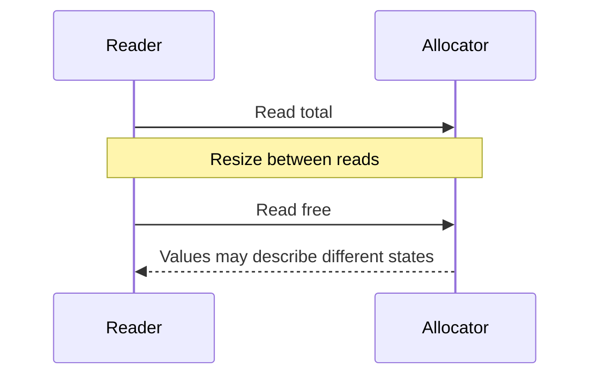
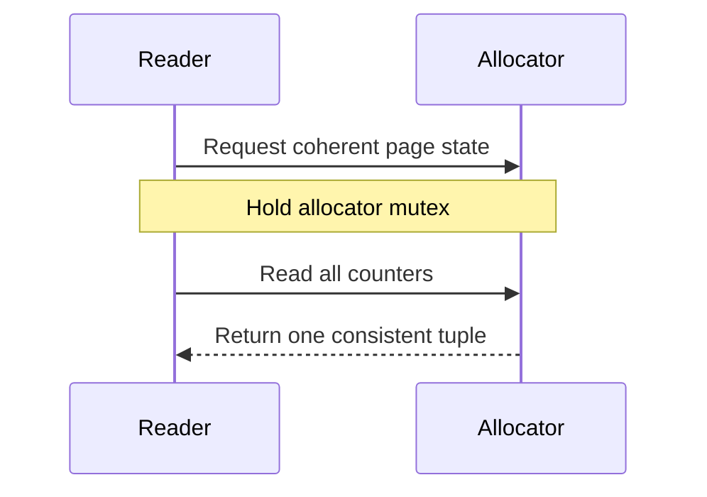

## The pool resized halfway through a reading

Monitoring asks for the total number of pages and then the number of free pages. If the pool grows between the calls, one figure describes the smaller pool and the other describes the larger one. Displaying them side by side can give a picture that never existed.

There was also a problem with reading just one field. Writers held a mutex, but readers accessed ordinary C++ integers without taking that lock. A concurrent read and write could race.



## Reading one counter or taking a snapshot

The free-page getter now reads its counter atomically. The scheduler’s full capacity calculation also checks available physical memory and reserved pages. Reading the reserved-page count still takes the allocator lock. When monitoring needs the total, free, in-use and reserved counts together, it calls `get_page_state()` and reads those four counters under one lock. It reads available physical capacity separately.



```cpp
int64_t PageAllocator::get_num_free_pages() const {
  return num_free_pages_.load(std::memory_order_relaxed);
}

PageState PageAllocator::get_page_state() const {
  std::lock_guard<std::mutex> lock(lock_);
  return get_page_state_unlocked();
}
```

The threads changing the counts use the same mutex. The inner helper is called `unlocked` because its caller already holds the lock. [Allocator source](https://github.com/ovg-project/kvcached/blob/d40c4ce8aa761f809e4d6d2d57d30ce8a295000a/csrc/page_allocator.cpp#L443-L476)

## What did locking cost?

The PR ran Qwen2.5-3B on a T4. Across three rounds, median total throughput was 2501.87 tok/s for the original code, 2458.83 with a mutex on every getter, and 2504.00 with atomic reads and a locked snapshot. The last version stayed close to the original on this workload. A separate test checked the snapshots while the pool went through 1,000 shrink-and-expand cycles. [Test results](https://github.com/ovg-project/kvcached/pull/443)
