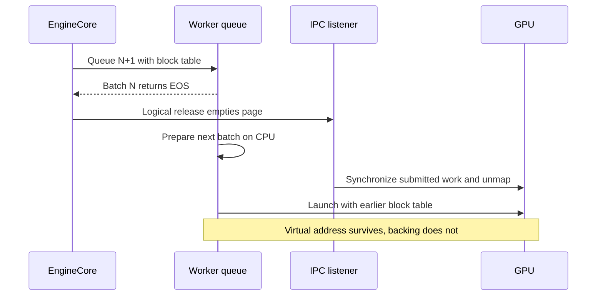
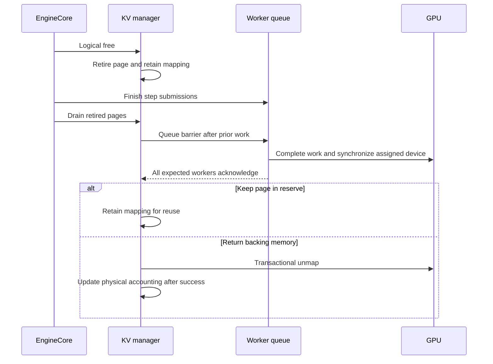

## One batch finished with the next one already queued

With asynchronous scheduling, the CPU can hand batch N+1 to a worker before the GPU finishes batch N. If batch N reports that a request has ended, the engine releases its cache blocks. But batch N+1 already has a block table and may still read one of the addresses in it.

The old path unmapped the physical page as soon as its block count reached zero. Even synchronizing the GPU at that point could be too early. The worker might still be preparing the next batch on the CPU, with the kernel that reads the page yet to launch.



## Put release behind the last possible reader

When the engine uses a batch queue, the manager marks an empty page for release and keeps it mapped. Reusing it cancels the mark. After submitting a step, the engine queues a barrier only if there are still pages to release. Once every expected worker finishes earlier work and synchronizes its device, the allocator can safely reclaim the pages. It may keep a page mapped in its reserve for reuse. GPU memory returns to the device when the allocator actually unmaps it.

The `external_launcher` executor can only get an acknowledgment from its local worker. This version rejects that executor at startup with pipeline parallelism (PP > 1), or with tensor parallelism (TP > 1) and asynchronous scheduling enabled. [Startup guard](https://github.com/ovg-project/kvcached/blob/6d2e3462b201f1c12ccca4e3e281d4233c8e2fc7/kvcached/integration/vllm/patches.py#L1175-L1191)



This excerpt shows the order at the end of an engine step. The marker identifies the pages eligible for this release. If the barrier or release fails, the manager keeps the pending record. It invalidates its cached capacity reading once the allocator accepts the pages. [Engine integration](https://github.com/ovg-project/kvcached/blob/6d2e3462b201f1c12ccca4e3e281d4233c8e2fc7/kvcached/integration/vllm/patches.py)

```python
result = original_step(self, *args, **kwargs)
marker = manager.capture_physical_release_marker()
manager.release_retired_pages_through(marker)
return result
```

## Check memory access as well as request completion

The tests used a controlled worker queue and real CUDA pages to exercise normal release, preparation failure, a lost success response, and reuse before release. The reuse case read the page back 16 times to check its contents remained accessible.

The serving test alternated the previous PR revision and the fix on one T4 with vLLM 0.28 and Qwen2.5-0.5B. Both completed all 128 requests in each round without serving-time CUDA errors. Mean output throughput across two rounds each was 1625.39 and 1610.33 tok/s respectively, about 0.93% lower for the fix in this sample. Cleanup warnings appeared after explicit shutdown. This run covered a single GPU. [Fault tests and serving results](https://github.com/ovg-project/kvcached/pull/464)
