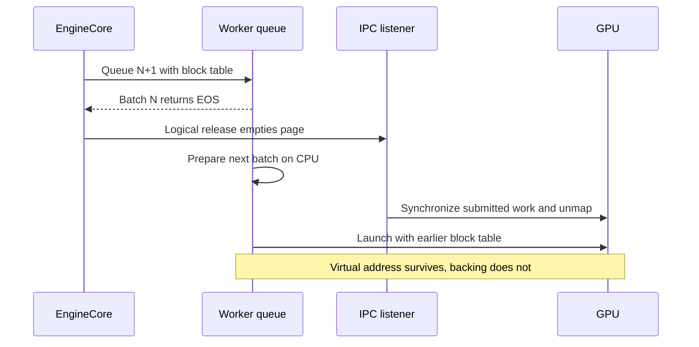
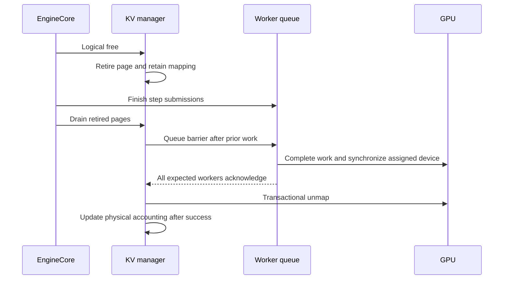

## EOS can arrive while another batch is still queued

Async scheduling overlaps CPU scheduling with GPU execution. When batch N reports that a request has finished, batch N+1 may already be queued with an earlier block table. Releasing logical blocks does not mean their physical backing can disappear immediately.

The old path freed a physical page as soon as its blocks became unused. Synchronizing in an IPC listener was insufficient: CUDA synchronization waits for submitted GPU work, not a future kernel that another thread is still preparing on the CPU.



## Retire first, then establish queue ordering

The fix separates logical release from physical release. Empty pages receive a retirement epoch but remain mapped. Reusing a page cancels its previous retirement. Only pages still retired proceed to release.

After the original engine step returns, including submission of deferred sampling, a release barrier enters the worker queue behind prior work. Every expected worker must complete preceding work, synchronize its assigned device and acknowledge. Transactional unmap follows; physical accounting changes only after it succeeds.



The step wrapper shown in the public PR preserves the native result and does not consume native futures itself:

```python
result = original_step(self, *args, **kwargs)
marker = manager.capture_physical_release_marker()
manager.release_retired_pages_through(marker)
return result
```

[Merged engine integration](https://github.com/ovg-project/kvcached/blob/6d2e3462b201f1c12ccca4e3e281d4233c8e2fc7/kvcached/integration/vllm/patches.py)

## Atomic release is not ordered release

A transaction answers whether mapping changes complete consistently. A queue barrier answers whether earlier users have finished. Neither replaces the other. With no retired pages there is no barrier; barrier or unmap failure retains retirement ownership rather than reporting prematurely freed capacity.

This change adds no physical-growth lock, admission policy or retry backoff. Deferral follows the actual initialized batch queue, not merely an async flag. Multi-rank queued external-launcher configurations that cannot establish an all-rank barrier are rejected early; a local acknowledgement is not evidence of global completion.

## What was validated

The final candidate's public evidence includes real CUDA pages with controlled worker queues and the IPC listener: normal release, a lost successful response, prepare failure, and 16 readback cycles after retired-page reuse. These check mapping retention and recovery, not full multi-GPU serving.

An alternating serving A/B used one T4, vLLM 0.28 V1 and Qwen2.5-0.5B. Mean output throughput was 1625.39 tok/s for the previous PR head and 1610.33 for the candidate, a 0.93% decrease in a small sample, not a speedup. All requests and output tokens completed without serving-time CUDA errors. Intentional shutdown produced separately recorded cleanup warnings; clean shutdown, TP/PP, MPS and multi-instance performance were not established by this experiment.

[PR #464: ordering, boundaries and validation](https://github.com/ovg-project/kvcached/pull/464)
