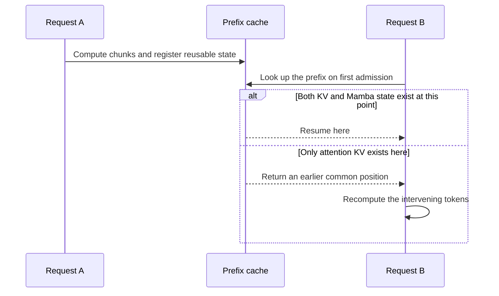

## Where the 23× figure came from

After an internal inference service upgrade, eight concurrent requests sharing a long prefix took a long time to produce their first tokens. Later requests with the same prefix were fast. I started with CPU offloading. In a separate test with two long requests, bytes read from the CPU were about 23 times the bytes written in the same window. If we were copying the same KV blocks dozens of times, optimizing model execution could wait.

I repeated the measurement with eight requests sharing one long prefix, taking counter snapshots at the start and end. External cache supplied one prefix and the GPU cache supplied seven times as many tokens. The bytes read back also matched a single copy of the prefix. My earlier ratio compared all reads in a window with all writes in that window. I had no way to match those bytes to the same KV blocks or to the two requests. Back on the slow cold batch, all eight requests finished with **zero bytes** read from CPU. I turned to how they spent the time before their first tokens.

## Two runs both labeled “concurrency eight”

Both benchmark clients reported a concurrency of eight. I had only checked the client under test. When I compared request counters across the whole measurement window, I found another concurrent batch competing for compute during the upgrade test.

I repeated the run with only the target workload and checked that counters for other traffic stayed flat throughout. For the public comparison, I set baseline mean time to first token (TTFT) to 100. The upgrade scored **347** under the extra load and **186** at matched load. There was still a regression, but it was much smaller than the first comparison suggested.

## Eight finished requests looked like eight preemptions

For the matched-load runs, the engine measured two intervals within client TTFT: queue entry to first admission, and first admission to first token. I compared each interval at its own boundaries and left the difference from client timing unattributed. **About 78% of the TTFT increase came before first admission.** I nearly started tracing preemption and retry after failed KV allocation. The preemption histogram's `_count` had risen by exactly eight.

Then I checked the `_sum` delta for the same window. It was zero. Each finished request contributed one observation to the histogram, and all eight recorded zero preemptions. There were writes from GPU to CPU, but their cumulative copy time was less than 1% of mean TTFT in this batch. I still didn't know how long successful allocations took. But chasing preempted requests wouldn't explain this batch. **How much work had the requests at the front of the queue actually done?**

## The missing hits showed up in local compute

I accounted for all input tokens across the eight requests. The table uses one complete prompt as the unit, so total input is eight in each run.

| Source of input tokens    | Baseline | Upgrade |
| ------------------------- | -------: | ------: |
| Local GPU cache hit       |     6.68 |    5.79 |
| Local prefill computation |     1.32 |    2.21 |

Every missing hit showed up as a token computed locally. On the original counters the two deltas matched exactly, equivalent to **0.89 of a complete prompt**.

If much of the difference was concentrated in one request, the per-request histogram should have one more large observation. I subtracted the delta in a cumulative bucket whose upper bound was about three fifths of a prompt from the number of completed requests in the same window. The baseline gave **8 − 7 = 1** long prefill. The upgrade gave **8 − 6 = 2**. The extra work came with an extra long prefill. If it occupied earlier scheduler steps, even requests that eventually hit the cache could spend longer in the queue. That gave me a reason to investigate why the common prefix had yielded less reuse.

## A cold batch still has a second request

I had expected retention to matter on the next run. I was treating a benchmark run as if it were a single request. The eight requests arrive together, but the scheduler handles a long prompt in chunks. By the time B gets its first turn, A may have computed a substantial part of their common prefix.

The model has both attention and Mamba layers. To resume partway through the prompt, B needs the attention KV **and** the Mamba state at the same position. The diagram shows one possible timing. The counters tell us how much extra work happened across the batch. They do not identify the exact position B looked up. [How the hybrid cache reconciles hit lengths](https://github.com/vllm-project/vllm/blob/ced6857afa0ea7b2e3f0846a62e1394e90f15607/vllm/v1/core/kv_cache_coordinator.py#L841-L867)

## Change one setting and repeat the cold batch

Tracing backward from the hybrid cache lookup brought me to the code that decides which Mamba states to register. I compared the effective settings in both environments. Prefix caching was enabled and the scheduler block sizes matched. Neither command line mentioned `prefix_cache_retention_interval`, but the defaults differed. On the baseline, `None` kept eligible checkpoints densely. After the upgrade, `0` kept selected positions such as replay boundaries and known shared-prefix junctions. That gave me a prediction I could test. If the new retention policy cost us those hits, switching back to dense retention alone should make the extra long prefill disappear. [Mamba checkpoint selection](https://github.com/vllm-project/vllm/blob/ced6857afa0ea7b2e3f0846a62e1394e90f15607/vllm/v1/core/single_type_kv_cache_manager.py#L1578-L1625) · [Cache setting definition](https://github.com/vllm-project/vllm/blob/ced6857afa0ea7b2e3f0846a62e1394e90f15607/vllm/config/cache.py#L148-L155)

On the comparison instance I kept the model runner, GPU memory management and CPU offloading in place. I added just `--prefix-cache-retention-interval None`. I used a fresh prefix and again sent eight requests to one instance. Only **one** request exceeded the same threshold. The raw count of locally computed tokens matched the baseline exactly.

| First-batch mean (baseline TTFT = 100) | Queue before admission | Client TTFT |
| -------------------------------------- | ---------------------: | ----------: |
| Baseline                               |                     65 |         100 |
| Upgrade, default retention             |                    132 |         186 |
| Upgrade, dense retention               |                     85 |         124 |

I stopped there. With dense retention, the extra long prefill disappeared and computed tokens matched the baseline. The two upgrade runs had mean TTFTs of **186 and 124**. Their difference was about **72%** of the original regression, most of it in the queue before first admission. The pale bars include prefill and the difference between client and engine timing.

The retention settings ran on separate instances. The result supported my prediction about computed tokens, but I couldn't measure how much of that 72% latency difference came from retention alone. I also left the remaining 24% gap to baseline unattributed. Next time a cold batch is slow, my first question will be how many requests in it actually ran a long prefill.
