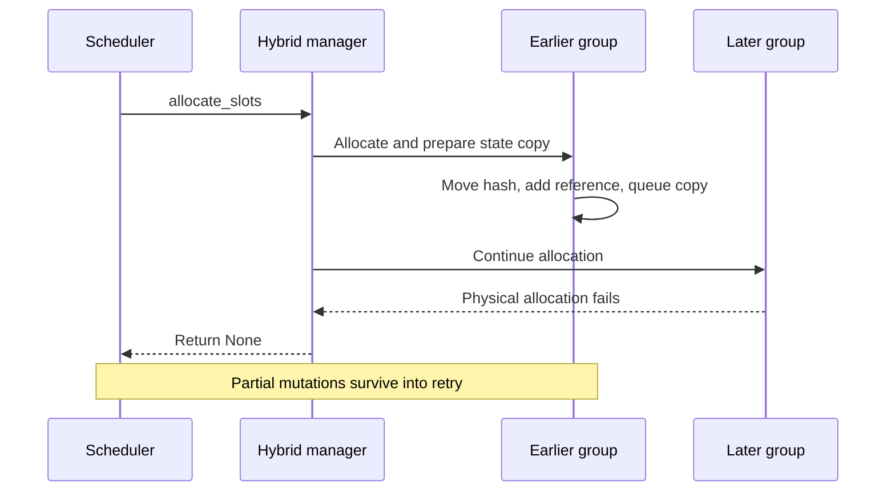
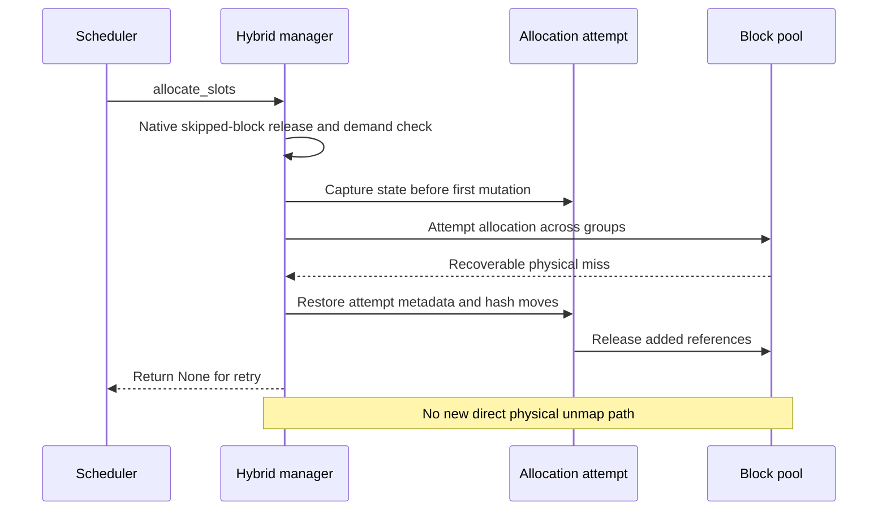

## What state does a retry actually start from?

An elastic physical allocation can fail recoverably: return an allocation miss and let scheduling retry later. But a hybrid allocation spans several cache groups. An earlier group may already own blocks, move hashes, increment references and queue a Mamba state copy before a later group runs out of physical capacity.

Catching the exception and returning None repairs the caller-visible result, not the mutated state. Waiting requests do not automatically unwind those allocations. Freeing the entire request is also wrong for a running request whose earlier blocks remain in use.



Native vLLM 0.29 performs these operations during allocation, before the worker has to begin computation:

```python
self.block_pool.move_block_hashes(source_block, cow_block)
self._pending_cow_copies.append((source_block, cow_block))
source_block.ref_cnt += 1
```

[Corresponding vLLM source](https://github.com/vllm-project/vllm/blob/98dff2a81d747d1dba01a47f939f48c3526d4206/vllm/v1/core/single_type_kv_cache_manager.py#L1737-L1755)

## Undo only the unpublished attempt

The fix captures necessary state after native skipped-block release and before the first allocation mutation. On a physical miss, it restores this attempt's request tables and Mamba bookkeeping, reverses its hash moves, truncates only newly appended copy/offload records, and releases surplus references through the existing reference-aware pool. Earlier ownership and already queued copies stay intact.



[Merged allocation_attempt.py](https://github.com/ovg-project/kvcached/blob/32858759eb11d94a1cc34aaf65004da70b46c5e9/kvcached/integration/vllm/allocation_attempt.py)

## An old boundary must not name an advanced state

Mamba running state advances during decode. At prompt boundary B, a copy preserves the checkpoint while the source continues toward B+1. If async scheduling republishes that running source under B using a stale request length, the next copy can store an advanced state under the boundary-B hash. Requests may still return HTTP 200 while a later prefix hit receives the wrong recurrent state.

The guard skips stale publication only for RUNNING requests whose publication boundary does not exceed their computed token count. First and chunked prefill, preempted replay and other native paths remain available. Both repairs are gated to vLLM 0.28/0.29, not future releases, and do not replace #464's physical-release ordering.

## Completion alone is not a correctness test

Public tests use real 0.28/0.29 managers for waiting, running and preempted requests, repeated misses, references and copy ownership. T4 checks use a tiny random Qwen3.5 hybrid checkpoint and inject real physical allocation misses after a copy is queued, checking complete requests, output tokens, recovery and shutdown.

Ordinary native/elastic comparisons were not universally token-identical. Further isolation checked all six Mamba conv/SSM tensors, the attention prefix and actual copy destinations before the first decode in the remaining 0.29 case: all were exactly equal. A KVCached-disabled native control then reproduced the same scheduling failure and cache recomputation, matching the corresponding fault run's complete outputs.

This separates state corruption from scheduling-induced differences in a near-tied FP16 fixture. HTTP success does not prove state correctness, and different output tokens alone do not prove a bad copy. The evidence qualifies scoped ownership and state recovery, not full-model quality, multi-rank behavior or serving throughput.

[PR #518: reproduction, source and validation boundaries](https://github.com/ovg-project/kvcached/pull/518)
