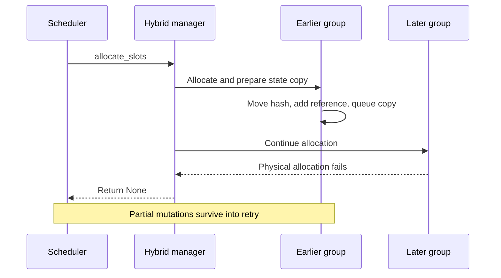
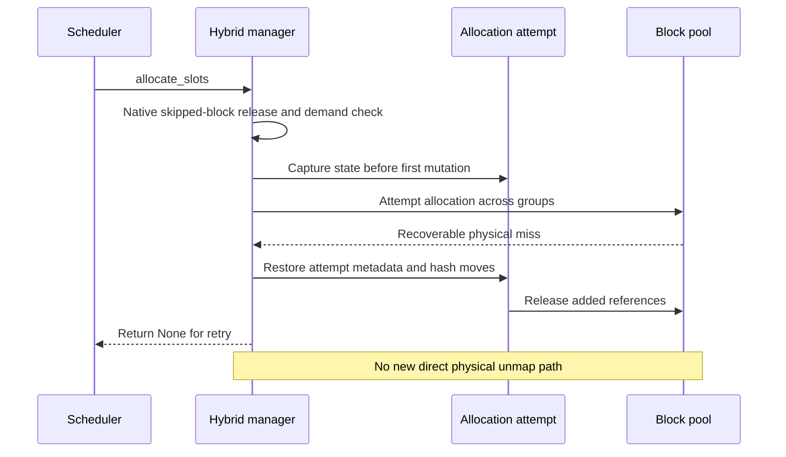

## The first group had already changed when the second ran out of memory

A request may need space for both attention data and Mamba state. vLLM allocates the cache groups in turn. If the second group runs out of memory, the scheduler can try again later. By then the first group may already have moved a cache key, taken another reference to the source block, and queued a state copy. The next attempt would inherit those changes.



These three lines run during allocation. They record a future copy and keep its source block alive. The worker has yet to run the model. [vLLM’s Mamba allocator](https://github.com/vllm-project/vllm/blob/98dff2a81d747d1dba01a47f939f48c3526d4206/vllm/v1/core/single_type_kv_cache_manager.py#L1737-L1755)

```python
self.block_pool.move_block_hashes(source_block, cow_block)
self._pending_cow_copies.append((source_block, cow_block))
source_block.ref_cnt += 1
```

## Undo only what this attempt added

A running request still needs blocks allocated on earlier steps. The rollback applies to the cache coordinator in vLLM 0.28.x and 0.29.x. It records the existing request state after vLLM frees its skipped blocks and before this attempt makes its first change. On a recoverable failure it restores the keys and metadata moved by this attempt, removes its new copy records, and drops its extra references. Earlier blocks and queued work survive the retry. [Rollback implementation](https://github.com/ovg-project/kvcached/blob/32858759eb11d94a1cc34aaf65004da70b46c5e9/kvcached/integration/vllm/allocation_attempt.py)



## A second bug surfaced on a later cache hit

Suppose the cache contains the Mamba state after token B. After another token, the working block has advanced to B+1, but the asynchronous scheduler may still see a request length of B. Publishing that working block under B again could give the next request a state one step ahead of where it should start.

For a running request, the fix skips that stale publication at an already computed position. First-time prefill, chunked input and replay after preemption can still save state as usual.

## Force a failure, then inspect the state used to resume

The PR tested repeated misses, preemption and retries with the vLLM 0.28 and 0.29 managers. On a single T4 with a tiny random Qwen3.5 hybrid model, it also forced a physical allocation failure after the copy was queued and let the requests run to completion.

One 0.29 case produced different tokens from an ordinary run. Before the first decode, all six Mamba state tensors, the attention prefix and the actual copy destinations matched exactly. Reproducing the same scheduling failure and recomputation with KVCached disabled then gave matching full outputs. That comparison separated a change in batch scheduling from corruption during recovery. [Experiments and controls](https://github.com/ovg-project/kvcached/pull/518)
