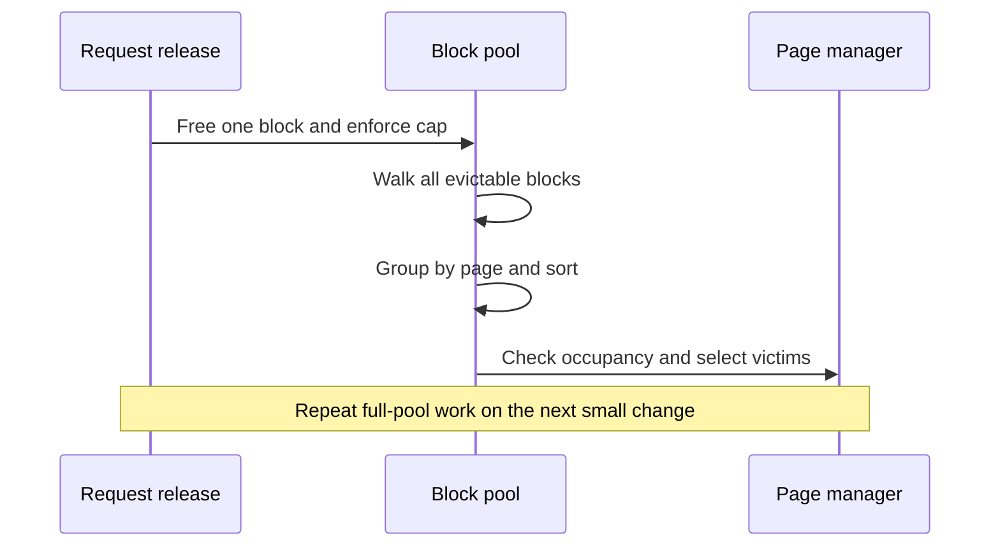
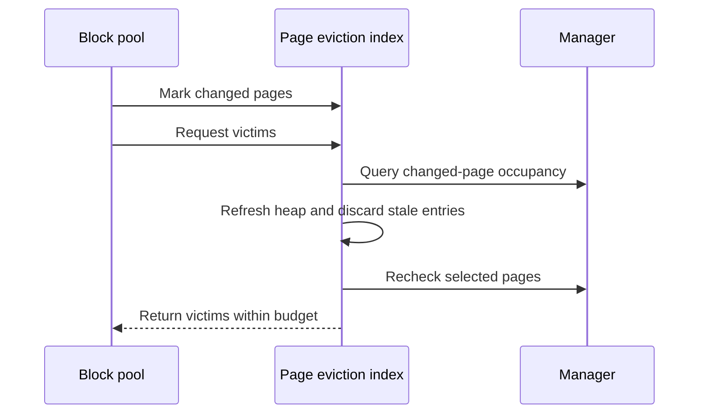

## One block changes; the whole pool gets rebuilt

A prefix-cache cap keeps useful blocks without retaining unlimited memory. The old trim path enforced that cap by walking evictable blocks, regrouping them by physical page and sorting candidates. As the retained pool grew, even a single-block release paid for reorganizing the whole pool.

This was CPU scheduling work, not a slower GPU kernel. Retaining 1,000 blocks while repeatedly freeing one block made the cost measurable in isolation.



## Keep unchanged pages in the index

The replacement maintains a page-level eviction index. Adding, removing or reusing a block marks its page dirty. Trimming refreshes those pages rather than rebuilding every candidate. A heap preserves cost and recency ordering; versioned entries invalidate stale candidates, and periodic compaction bounds heap growth.

The manager remains the authority on physical occupancy. A page can contain a null block or blocks retained for pending copies, so the prefix index alone cannot prove that the entire page is releasable. Selected pages receive another occupancy check. LRU top-up stops once it has enough victims.



The merged `changed()` method records affected pages instead of rebuilding the pool:

```python
def changed(self, block_ids: Iterable[int]) -> None:
    self.dirty.update(self.page_id(bid) for bid in block_ids)
```

[Merged PageEvictionIndex source](https://github.com/ovg-project/kvcached/blob/9677e504960edd4ccc7a820592e28b5df7bbd9f3/kvcached/integration/vllm/page_eviction.py)

## What the measurements establish

The initial public experiment used a T4, vLLM 0.28, real native metadata and CUDA backing. With 1,000 retained blocks and 2,000 measured single-block frees after warmup, mean contiguous trim time fell from 260.5 to 17.4 microseconds. Non-contiguous trim fell from 259.6 to 17.5 microseconds. A follow-up with localized manager-release notifications measured around 19–20 microseconds.

These are eviction microbenchmarks, not a claim that model serving became an order of magnitude faster. Both arms retained 1,000 blocks with 256 MiB mapped. Victim-order comparisons, bounded-work regressions and real CUDA release checks help distinguish implementation savings from retaining less cache or changing the policy.

## The easily missed invalidation path

Every occupancy-changing path must update the index, including manager-side releases outside ordinary block-pool methods. Those notifications must stay local to affected pages; invalidating everything on every release would recreate the original cost.

The strict cap and cheapest-page/LRU policy remain intact. This change reduces the cost of enforcing that policy rather than introducing a new scheduling policy.

[PR #538 and public validation](https://github.com/ovg-project/kvcached/pull/538)
