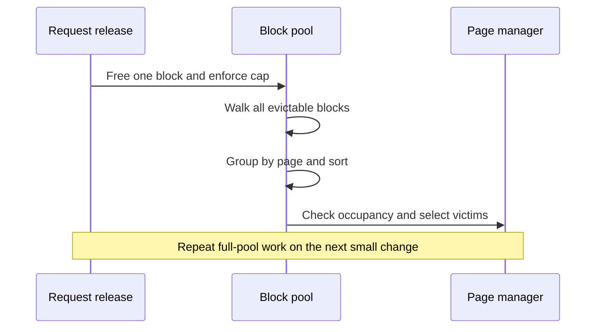
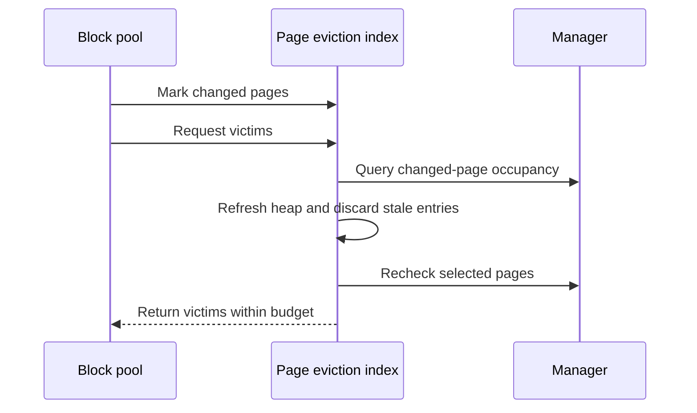

## What did the CPU do to free one block?

A prefix cache holds on to computed blocks so later requests can reuse them. When it exceeds its cap, the pool has to choose some blocks to evict. The old code grouped every eligible block by physical page and sorted the candidates to find the cheapest page. Freeing a single block could send it through the entire pool again.

Holding the cache at 1,000 blocks and freeing one block at a time made that CPU cost easy to measure.



## Remember which pages changed

When a block enters the cache, leaves it, or gets reused, the index records the page it belongs to. The next trim updates those pages and reuses the existing order for the rest. Before evicting a selected page, it checks occupancy with the manager because a pending copy or another user may still hold a block there. [Page index](https://github.com/ovg-project/kvcached/blob/9677e504960edd4ccc7a820592e28b5df7bbd9f3/kvcached/integration/vllm/page_eviction.py)

```python
def changed(self, block_ids: Iterable[int]) -> None:
    self.dirty.update(self.page_id(bid) for bid in block_ids)
```



The manager can also free a block outside the cache index. It needs to tell the index which pages changed, or an eligible page could stay off the list indefinitely. If the pool still needs more victims, it takes the least recently used blocks and stops once it has enough.

## Repeat the measurement at the same cache size

On a T4, both versions retained 1,000 blocks with 256 MiB mapped. Across 2,000 single-block frees after warmup, mean trim time fell from 260.5 to 17.4 microseconds with contiguous blocks, and from 259.6 to 17.5 with scattered blocks. After the manager’s release notification was added, the mean was around 19–20 microseconds.

The cap was the same in both versions. Regression tests also compared the order in which they evicted blocks. The timings measure the scheduler’s work on a single trim. [Benchmark setup and results](https://github.com/ovg-project/kvcached/pull/538)
