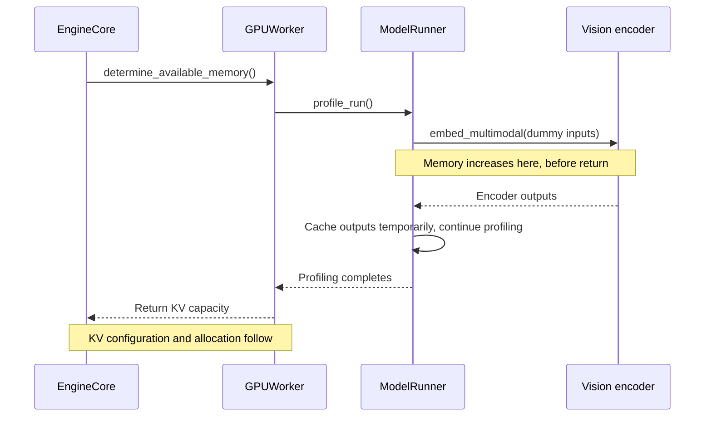
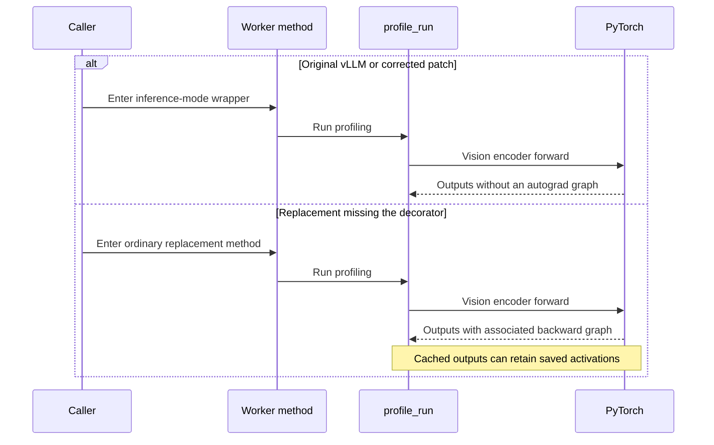

## Memory jumped before the KV cache was allocated

In #448 I replaced a vLLM startup method so instances sharing a GPU could each estimate their cache capacity. A small text model passed the startup check. With a multimodal model, the same input took the process from about 2.9 GiB to 14.06 GiB. My first suspect was the new budget calculation. [Earlier change](https://github.com/ovg-project/kvcached/pull/448)

Measuring each stage narrowed it down to the vision encoder processing its test image. The method that estimates available memory had yet to return. vLLM would only start allocating KV tensors after that.



## Compare the same line in both runs

The container image, model, startup arguments and profiling inputs were held constant. Only the patch file changed. Both vision encoders received a `bfloat16` image tensor of shape `(65536, 1536)`. PyTorch reported the same tensor memory going in. By the time the call returned, the two runs were already more than 12 GiB apart. [Original measurements](https://github.com/ovg-project/kvcached/issues/460)

| Measurement            |   Before #448 |       With #448 |
| ---------------------- | ------------: | --------------: |
| Allocated before embed |     0.867 GiB |       0.867 GiB |
| Allocated after embed  |     0.944 GiB |       13.13 GiB |
| PyTorch peak           |     1.943 GiB |       13.62 GiB |
| Process footprint      | About 2.9 GiB | About 14.06 GiB |

## The missing line belonged to the caller

In vLLM 0.22.1 the outer worker method has a `@torch.inference_mode()` decorator. The inner `profile_run()` relies on that setting. #448 replaced the entire outer method. It called the same encoder, but the decorator still wrapped the old function. [Worker entry point](https://github.com/vllm-project/vllm/blob/v0.22.1/vllm/v1/worker/gpu_worker.py#L357-L373) · [Encoder call and temporary cache](https://github.com/vllm-project/vllm/blob/v0.22.1/vllm/v1/worker/gpu_model_runner.py#L6104-L6161)

With gradient recording on, PyTorch could save intermediate tensors for a backward pass. The profiler temporarily kept the encoder outputs, and those outputs could keep the graph alive. That explained why so much memory was still in use after the encoder returned.



## Check the mode inside the profiling call

#461 restored the decorator on the replacement. The model still runs with the same input and budget calculation. [Merged fix](https://github.com/ovg-project/kvcached/blob/60cad949389af6bbf1d65c4eddf325113df5a9eb/kvcached/integration/vllm/patches.py#L2058-L2069)

```python
@torch.inference_mode()
def _patched_determine_available_memory(
    self, *args: Any, **kwargs: Any
) -> int:
    ...
```

A test that only checked the resulting capacity could pass with the decorator missing. The regression test now inspects two flags from inside the model profiling and CUDA Graph memory calls. It checks that gradient recording is off and inference mode is on. [Regression tests](https://github.com/ovg-project/kvcached/blob/60cad949389af6bbf1d65c4eddf325113df5a9eb/tests/test_vllm_virtual_kv_capacity.py)

```python
assert torch.is_grad_enabled() is False
assert torch.is_inference_mode_enabled() is True
```
