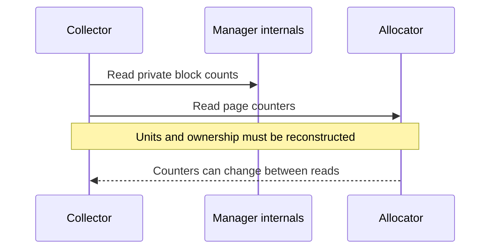
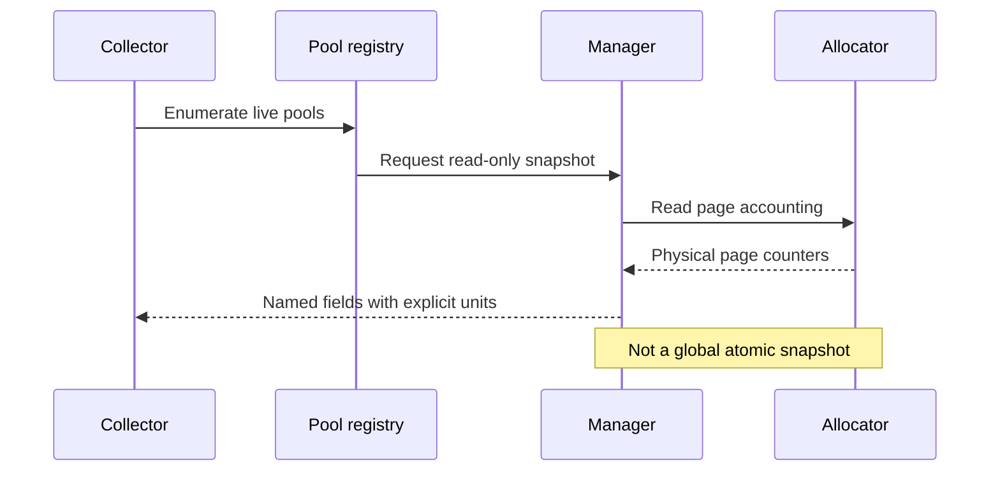

## Three valid sizes for one pool

In the PR’s RTX 4090 test, a small KV cache pool reserved 32 MiB of address space. GPU memory backed 8 MiB of it. The blocks allocated at the first reading accounted for just 512 bytes. The block count includes blocks the manager keeps in reserve. Those numbers answer three different questions about the same pool.

Monitoring used to have to extract the figures from private manager and allocator fields. A size reported for one layer and one buffer still needed multiplying by the correct number of layers and buffers to describe the whole pool.



## Ask the pool for its own figures

Pools created by vLLM and SGLang register themselves. Inside the engine process a collector can request snapshots for the live pools, optionally by integration. It can then filter the results by pool name or group ID and forward them to its monitoring service. The registry uses weak references so a collector can discover a pool without keeping it alive.



This code converts per-buffer sizes to pool-level units. Available capacity also depends on whether the free logical pages can be backed by GPU memory. If an allocator cannot provide that figure, the snapshot reports it as unknown so a dashboard can distinguish a missing reading from an exhausted pool. [Byte accounting](https://github.com/ovg-project/kvcached/blob/c85bac20e5ccb04766f995512abbff0dfbca1055/kvcached/observability.py#L183-L186) · [Available pages](https://github.com/ovg-project/kvcached/blob/c85bac20e5ccb04766f995512abbff0dfbca1055/kvcached/observability.py#L166-L173)

```python
virtual_bytes_per_buffer = _int_attr(manager, "mem_size") or 0
virtual_per_layer_bytes = virtual_bytes_per_buffer * num_kv_buffers
block_size_bytes = _int_attr(manager, "block_mem_size") or 0
bytes_per_block = block_size_bytes * num_layers * num_kv_buffers
```

## Allocate 32 blocks, read the counters, then give them back

Across the three readings the block count went from 1 to 33 and back to 1. The corresponding byte count rose from 512 to 16,896 and returned to 512. That gives the collector a known change against which to check the units. [RTX 4090 test](https://github.com/ovg-project/kvcached/pull/385)

This first interface read the underlying counters one at a time. If a background thread resized the pool, different fields could describe different moments. A [later change](#/notes/allocator-snapshots) added a consistent set of allocator page counts.
