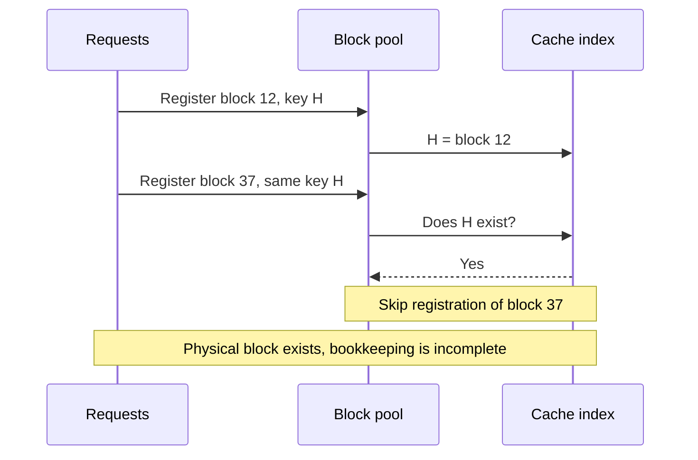
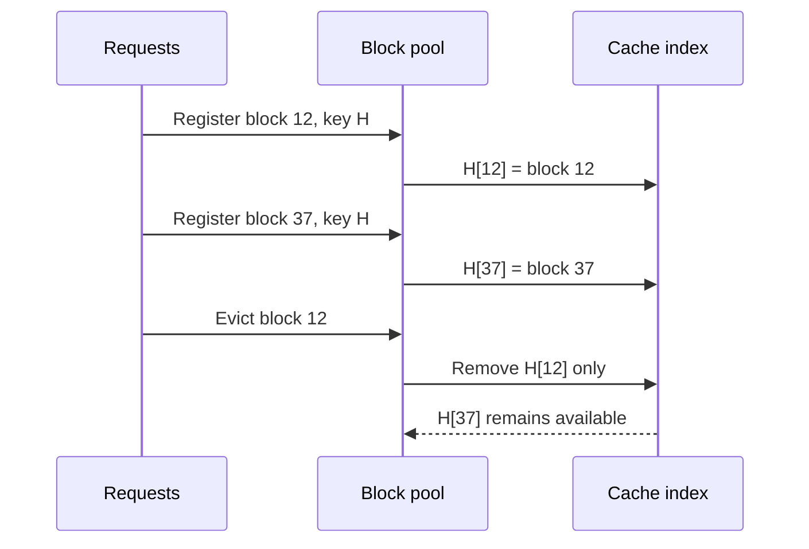

## One prefix, two block IDs

Imagine two requests computing the same prefix around the same time. One stores its result in block 12, the other in block 37. They share a cache group and a lookup key, H. A later request can reuse either copy. When it comes time to free memory, the pool needs a record of both.

The old index registered block 12 under H. When block 37 arrived, the existing key made the code skip registration. Block 37 was occupying storage, but its hash and reverse-index entry were missing. vLLM could then stop the engine when it checked the block and found an empty hash.



## Look up by content and remove by ID

The index now keeps both 12 and 37 under H. A lookup still returns one usable block. Evicting 12 removes only its entry, so 37 remains available. H disappears once the last copy goes away. If a block is reused for different content, registration first removes its old entry. [Lookup](https://github.com/ovg-project/kvcached/blob/fc26d25b584841545ca1794057223f417ef5a4ae/kvcached/integration/vllm/patches.py#L458-L462) · [Registration](https://github.com/ovg-project/kvcached/blob/fc26d25b584841545ca1794057223f417ef5a4ae/kvcached/integration/vllm/patches.py#L574-L581)



```python
def _remove_cached_block(
    self, key: Any, block_id: int
) -> Optional[KVCacheBlock]:
    blocks = self._cached_blocks.get(key)
    if not blocks:
        return None
    block = blocks.pop(block_id, None)
    if not blocks:
        self._cached_blocks.pop(key, None)
    return block
```

[Removal by block ID](https://github.com/ovg-project/kvcached/blob/fc26d25b584841545ca1794057223f417ef5a4ae/kvcached/integration/vllm/patches.py#L464-L473)

## Evict one copy and look for the other

The regression test registers two blocks with the same prefix, then releases both and evicts just one. Looking up the shared prefix must still return the other block. All 30 prefix-cache tests passed. In a concurrent replay across two vLLM instances, all 1,440 requests completed without the missing-hash assertion. [Test results](https://github.com/ovg-project/kvcached/pull/402)
