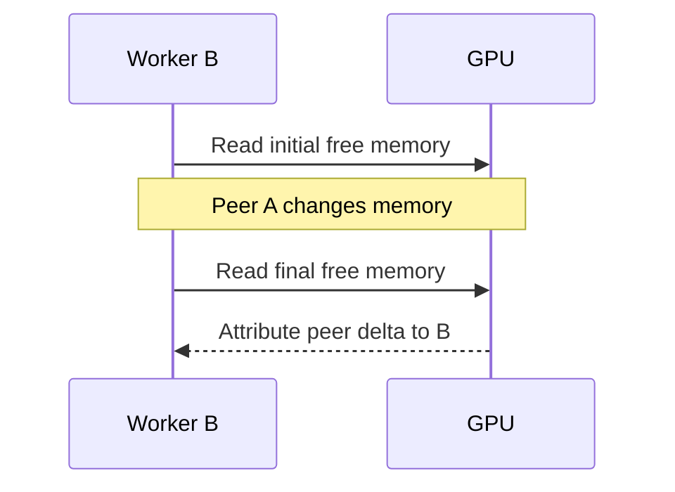
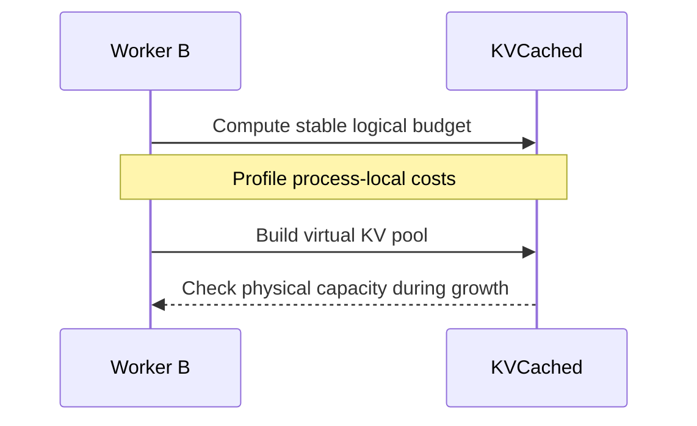

## More free memory made startup fail

vLLM runs the model at startup to estimate how much memory it can leave for the KV cache. In one shared-GPU run, the device reported 8.57 GiB free before profiling and 12.91 GiB afterward. The check expected profiling to consume memory. Seeing the change go the other way, it stopped the engine.

The readings covered every process on the card. Even if the instances started one at a time, the first could keep serving traffic and releasing memory while the second measured itself. [Failure report](https://github.com/ovg-project/kvcached/pull/448)



## Size the address space for this instance

An explicit `kv_cache_memory_bytes` setting goes through vLLM’s original method. When KVCached is enabled and the budget is calculated automatically, vLLM starts with total device memory times the configured utilization. It subtracts this instance’s weights and the increase in peak PyTorch memory during profiling. The result sizes the virtual space for its KV cache. Here is the simplified calculation. [Merged implementation](https://github.com/ovg-project/kvcached/blob/f8bbb005ed5c1eb9285e2e8f2afa7fc83b8da052/kvcached/integration/vllm/patches.py#L2071-L2126)

```python
# Simplified capacity formula, not the full worker method.
available_memory = (
    virtual_budget
    - weights_memory
    - torch_peak_increase
)
```



When the cache grows, the allocator checks whether it can actually back another page. Startup can still wait if the first physical page never becomes available. In SGLang, each rank calculates its own capacity and the group takes the smallest value so the individual pools agree on their size.

## What the startup checks missed

On one T4, vLLM 0.24.0 and SGLang 0.5.15 each started and answered a request. The SGLang run had CUDA Graph disabled. A later multimodal run exposed a separate omission in the replacement vLLM method. Its vision encoder used over ten extra GiB during profiling. The [follow-up note](#/notes/inference-mode) traces that regression. [Startup tests](https://github.com/ovg-project/kvcached/pull/448)
