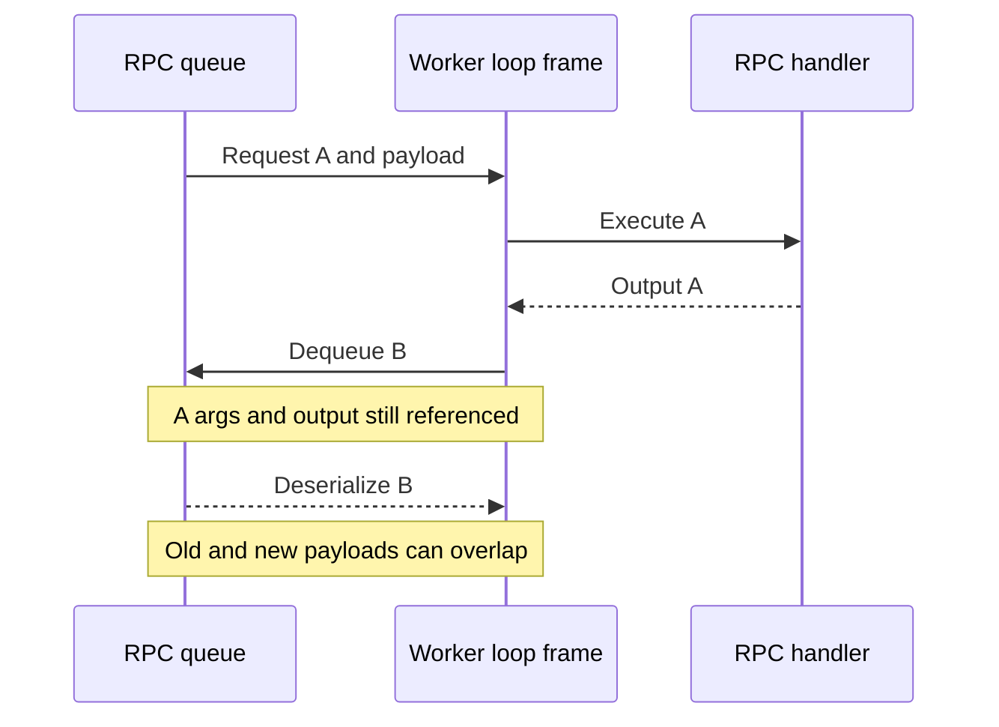
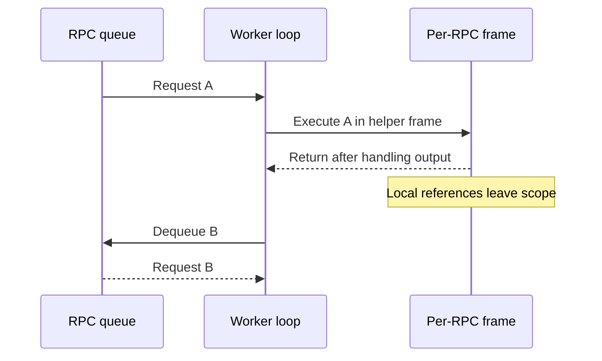

## Where the two requests overlapped

Suppose request A carries a large CPU tensor. The worker runs the method, sends back the result, and goes to the queue for request B. The two calls appear to be over and done with in order. The catch is in this assignment.

```python
method, args, kwargs, output_rank = self.rpc_broadcast_mq.dequeue(
    indefinite=True
)
```

Python evaluates the right-hand side before replacing the variables on the left. While the queue was unpacking B, `args` still pointed to A’s tensor. The loop could also hold A’s output. With large requests, that brief overlap raised peak CPU memory use.



## Give each call a place to end

The outer loop now fetches a message and passes it straight to `_execute_worker_rpc()`. That function unpacks the message, runs the method, and handles the response. Its local variables go out of scope before the loop asks for another message. The designated worker still sends the output and errors take the usual response path. [Worker loop](https://github.com/vllm-project/vllm/blob/4ca856b0b59d87c7b167d1bd8c748421719c9a57/vllm/v1/executor/multiproc_executor.py#L1029-L1033) · [Per-call handler](https://github.com/vllm-project/vllm/blob/4ca856b0b59d87c7b167d1bd8c748421719c9a57/vllm/v1/executor/multiproc_executor.py#L1035)

```python
def worker_busy_loop(self):
    """Main busy loop for Multiprocessing Workers"""
    assert self.rpc_broadcast_mq is not None
    while True:
        self._execute_worker_rpc(self.rpc_broadcast_mq.dequeue(indefinite=True))
```



## Check A at the instant the worker asks for B

The test kept a weak reference to A’s payload. When the second dequeue began, the old loop still had A. With the patch, A was gone. Watching process memory alone would have missed that distinction because an allocator can keep freed memory for later use.

For a throughput check, the PR also applied the method change to vLLM 0.18.0 and ran a small MoE model on one T4. The two-round averages were close, at 118.215 tok/s before and 118.222 after. The change addresses the overlap in memory use. [Test results](https://github.com/vllm-project/vllm/pull/51979)
