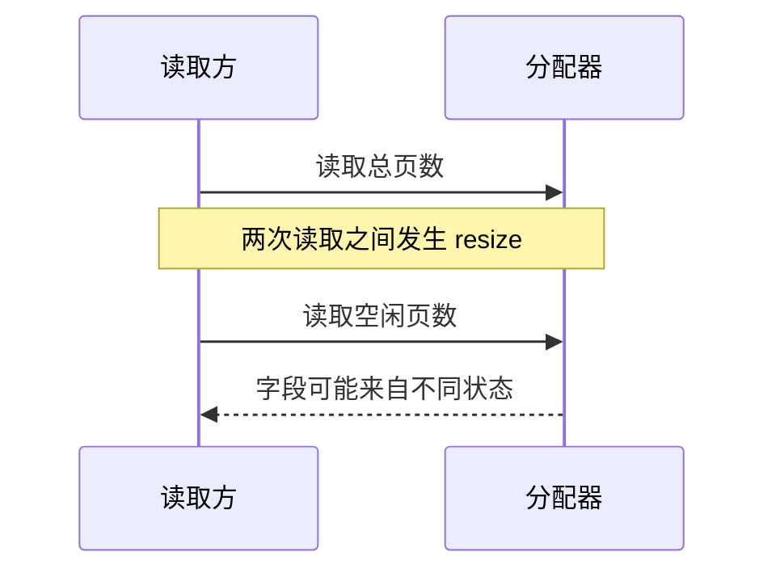
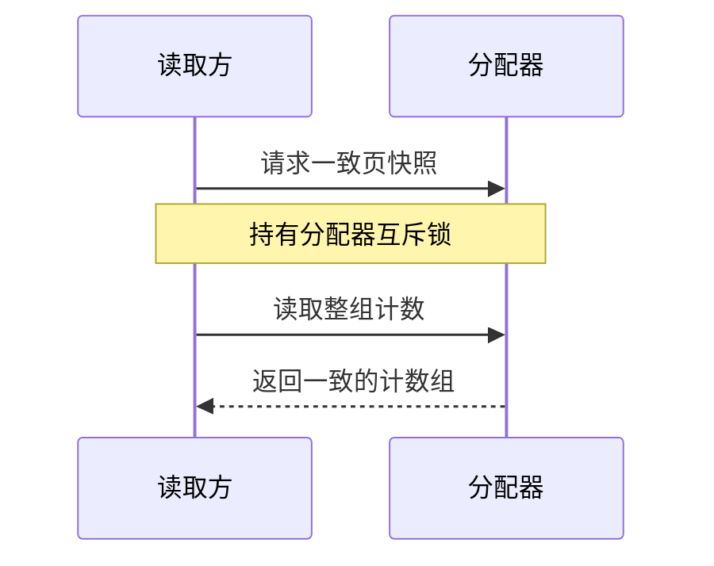

## 监控读到一半，缓存池扩容了

监控先问「池里一共有多少页」，再问「还有多少页空闲」。如果分配器在两次查询之间扩容，第一项是扩容前的，第二项是扩容后的。把它们放在一行里，就可能得到一组从来没有同时成立过的数字。

旧实现还有个更早的问题。写计数的线程拿了锁，读计数的线程却直接读普通整数。两个线程同时碰到同一个字段时，C++ 就可能发生数据竞争。



## 单独查空闲页，或一次读四个计数

空闲页数现在可以直接原子读取。调度器要算还能分配多少块，还得查可用物理显存和预留页，其中读取预留页数时仍要拿分配器的锁。需要比较总页数、空闲页、使用中和预留页时，监控改用 `get_page_state()`，拿一次锁，把同一个时刻的这四个计数带走。物理显存当前还能提供多少页，要另查一次。



```cpp
int64_t PageAllocator::get_num_free_pages() const {
  return num_free_pages_.load(std::memory_order_relaxed);
}

PageState PageAllocator::get_page_state() const {
  std::lock_guard<std::mutex> lock(lock_);
  return get_page_state_unlocked();
}
```

这把锁也管着后台改页数的线程。函数名里的 `unlocked` 表示外层已经拿好了锁，里面可以直接读。[分配器源码](https://github.com/ovg-project/kvcached/blob/d40c4ce8aa761f809e4d6d2d57d30ce8a295000a/csrc/page_allocator.cpp#L443-L476)

## 锁的开销有多大

PR 在 T4 上用 Qwen2.5-3B 对比了三种实现。三轮总吞吐的中位数分别是 2501.87 tok/s（原版）、2458.83（每次查询都加锁）和 2504.00（单项原子读、整组加锁）。在这组负载里，修复后的吞吐接近原版。另一项测试让池子缩容、扩容 1000 轮，同时检查快照里的计数能否对得上。[测试记录](https://github.com/ovg-project/kvcached/pull/443)
