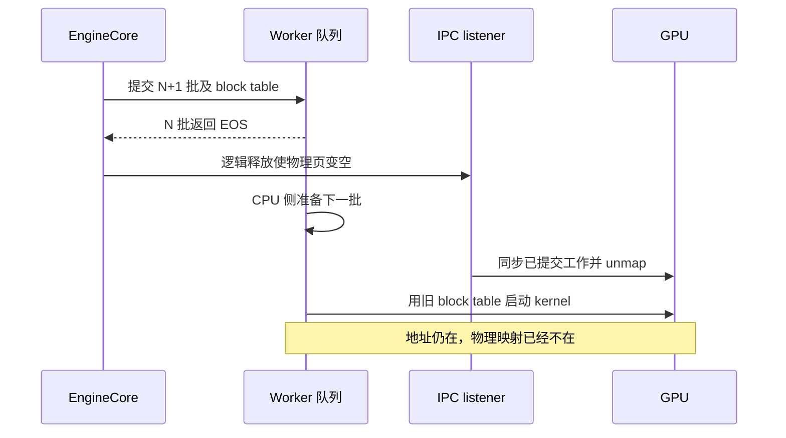
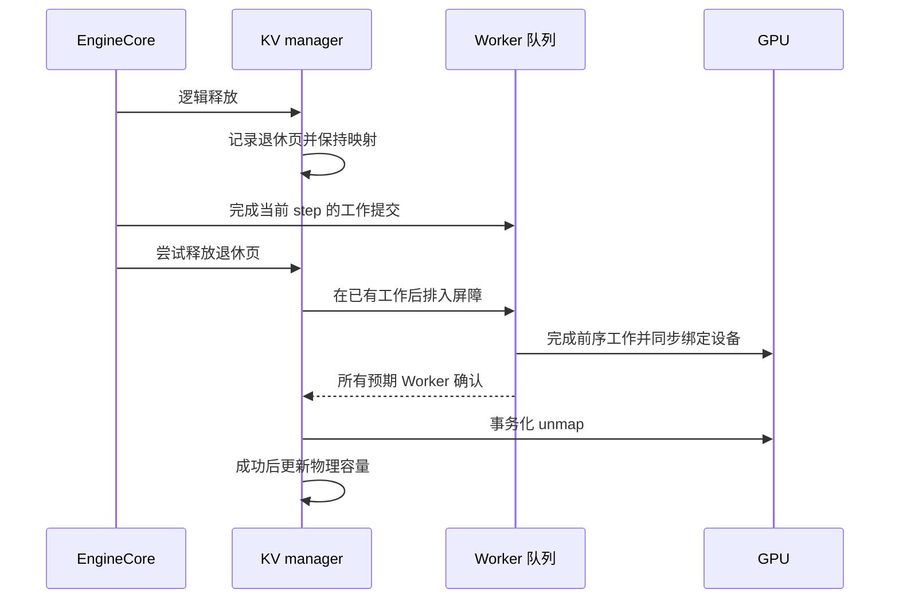

## EOS 返回时，后面可能还排着一批工作

异步调度把 CPU 调度和 GPU 执行重叠起来。第 N 批返回请求结束时，第 N+1 批可能已经进入 Worker 队列，里面仍带着之前生成的 block table。此时释放请求的逻辑块，不代表可以立刻撤销底层物理页映射。

旧路径发现页中没有使用中的块，就直接调用 allocator 释放。IPC listener 即使先执行 CUDA synchronize，也只能等待已经提交的 GPU 工作。如果 Worker 正在 CPU 上准备下一批元数据，还没有 launch kernel，这次同步不会等待那个未来的访问。



## 先退休，再沿 Worker 队列确认完成

修复把逻辑释放与物理释放拆开。空页先记录退休 epoch，保持映射；如果调度期间又用到它，取消旧的退休记录。只有仍然退休的页才进入释放流程。

原始 engine step 返回后，包括 deferred sampling 的提交已经完成，再向 Worker 队列发送释放屏障。所有预期 Worker 完成前面的工作、同步各自设备并确认后，才执行事务化 unmap。只有 unmap 成功，物理容量账本才随之更新。



公开 PR 中的 step wrapper 保留原生返回值，也不自行消费队列里的 future：

```python
result = original_step(self, *args, **kwargs)
marker = manager.capture_physical_release_marker()
manager.release_retired_pages_through(marker)
return result
```

[合入版引擎适配代码](https://github.com/ovg-project/kvcached/blob/6d2e3462b201f1c12ccca4e3e281d4233c8e2fc7/kvcached/integration/vllm/patches.py)

## 事务与执行顺序不是一回事

事务化 unmap 处理的是“多个映射变更是否一致成功”；队列屏障处理的是“释放时，之前的使用者是否已经结束”。两者缺一不可。没有退休页时不发屏障；屏障或 unmap 失败时保留退休所有权，不提前宣称容量已经释放。

这里没有引入物理增长锁、容量准入或退避策略。是否需要延迟释放，看实际初始化出来的 batch queue，而不是仅凭 async 开关推断。无法建立全 rank 屏障的多 rank queued external launcher 会提前拒绝，不能把本地 Worker 的确认当作所有 Worker 的确认。

## 验证到了哪里

最终候选的公开记录包含真实 CUDA 页、受控 Worker 队列与 IPC listener 的故障探针：正常释放、丢失成功响应、prepare 失败，以及退休页复用的 16 次读回检查。它们验证映射保留和恢复，不等于完整多卡服务测试。

单 T4、vLLM 0.28 V1、Qwen2.5-0.5B 的交替 A/B 中，两轮平均输出吞吐为旧 PR head 1625.39、新候选 1610.33 tok/s，低约 0.93%，不能写成加速。每轮请求和输出 token 完整，服务期无 CUDA 错误；主动退出后的清理警告另行记录，不宣称退出完全干净。该结果也不覆盖 TP/PP、MPS 或多实例性能。

[PR #464：根因、边界与测试记录](https://github.com/ovg-project/kvcached/pull/464)
