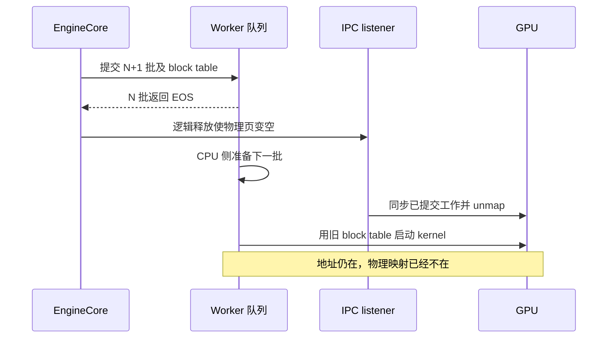
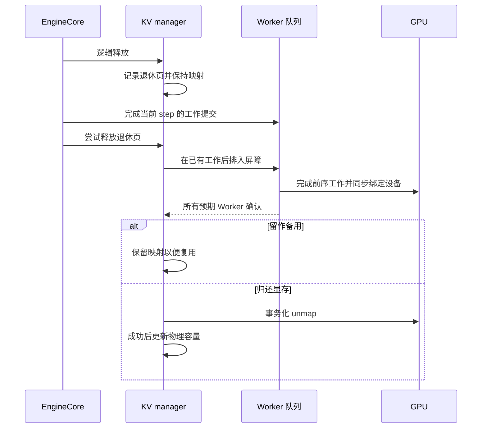

## 最后一批返回了，下一批已经在队列里

异步调度时，CPU 可以在 GPU 跑完第 N 批之前，就把第 N+1 批交给 worker。假如第 N 批返回了结束标记，引擎会释放请求占用的缓存块。问题是下一批手里已经拿到了块表，稍后还可能照着里面的地址读那一页。

旧代码一看页里没剩下使用中的块，就撤销物理显存映射。哪怕此时等一次 GPU 同步也可能太早。worker 也许还在 CPU 上准备下一批，真正读取这页的任务甚至还没交给 GPU。



## 让释放排在最后一次读取之后

引擎启用批次队列时，管理器会记下空页，先保留物理映射。中途又有人用这页，就取消这次待释放记录。一轮工作提交完毕后，只有还有页要回收，引擎才会在队尾放一个确认任务。等所有预期的 worker 跑完前面的工作并同步设备，分配器就可以安全回收这些页。它可以把页留在备用池里，下次直接复用。只有实际撤销映射的页才会腾出显存。

`external_launcher` 只能向本地 worker 确认。使用流水线并行（PP > 1），或使用张量并行（TP > 1）并开启异步调度时，这个版本会在启动阶段拒绝该配置。[启动检查](https://github.com/ovg-project/kvcached/blob/6d2e3462b201f1c12ccca4e3e281d4233c8e2fc7/kvcached/integration/vllm/patches.py#L1175-L1191)



下面是引擎一轮执行结束时的调用顺序。标记限定了这一次可以处理哪批待释放页。如果确认或回收失败，管理器会保留记录。分配器成功接收这些页后，管理器才会刷新缓存的容量读数。[引擎适配代码](https://github.com/ovg-project/kvcached/blob/6d2e3462b201f1c12ccca4e3e281d4233c8e2fc7/kvcached/integration/vllm/patches.py)

```python
result = original_step(self, *args, **kwargs)
marker = manager.capture_physical_release_marker()
manager.release_retired_pages_through(marker)
return result
```

## 怎样检查页是在正确的时刻释放的

测试用受控的 worker 队列和真实 CUDA 页，分别检查正常释放、准备失败、成功响应丢失，以及等待释放的页被重新使用。复用场景还做了 16 次读回，确认页里的数据仍然可读。

服务测试用了单张 T4、vLLM 0.28 和 Qwen2.5-0.5B。旧 PR 版本和修复版交替各跑两轮，每轮 128 个请求都完成了，服务期间没有 CUDA 错误。平均输出吞吐分别为 1625.39 和 1610.33 tok/s，修复版在这组样本里低约 0.93%。主动退出后仍记录到清理警告，多卡执行另需验证。[故障测试与服务数据](https://github.com/ovg-project/kvcached/pull/464)
