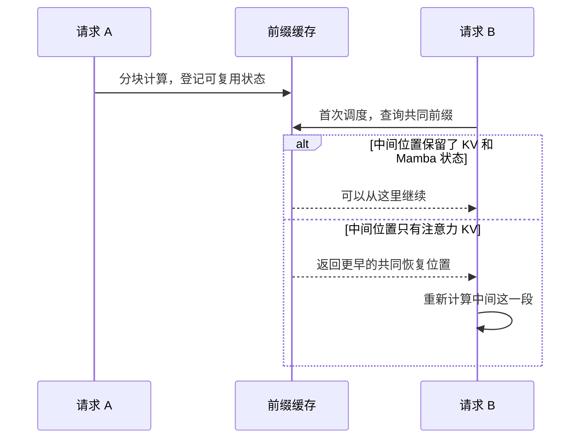

## 那个 23 倍是怎么算出来的

一次内网推理服务升级后，压测里最扎眼的是第一波请求。8 条请求共用一个长前缀，首 token 等得很久，后续热请求却很快。我最先去看 CPU offloading，因为另一次只发两条长请求的测试里，CPU 到 GPU 的读回量竟然是同期写出量的约 23 倍。如果同一批 KV 被来回搬几十遍，先改模型计算也没用。

我换了一个能对账的实验。单独发 8 条共享同一长前缀的请求，取开始和结束时的计数器差值。把三个计数器对齐，外部缓存恢复了 1 份前缀，本地命中量恰好是它的 7 倍，搬运的字节数也对得上一份前缀。我之前拿来相除的是整个窗口内两个方向的字节数，分子、分母没有对应到同一批 KV。那个 23 倍不能用来诊断这两条请求。回到出现延迟的首轮，8 条全跑完，CPU 读回量是 **0 字节**。接下来要查的是，这批请求在首 token 之前把时间花在哪了。

## 先把两边的 8 条请求对齐

直接拿旧基线和升级后的数字比较，还有一个坑。两轮压测都写着“并发 8”，我最初只核对了当前压测客户端。回看请求计数才发现，升级后的窗口里还有另一批并发请求在消耗同一份计算资源。

我只重跑这一组请求，用指标确认其他流量在整个窗口里都没有增加。为方便公开比较，下面把基线的平均首 token 延迟（TTFT）记为 100。负载没对齐时，升级环境约为 **347**；对齐后降到了 **186**。仍然有回退，但接下来要解释的差额已经小了很多。

## 我差点把八个完成请求当成八次抢占

我用两次同负载实验的指标拆客户端 TTFT。引擎记录了入队到首次调度、首次调度到首 token 两段时间。我按各自的起止事件比较，客户端与引擎计时没有覆盖到的差额单独留下。两轮相减，**约 78% 的 TTFT 增量发生在首次调度之前**。我一度打算追 KV 分配失败后的抢占重试，因为抢占直方图的 `_count` 刚好增加了 8。

再看同一窗口的 `_sum`，它是 0。这个直方图每完成一个请求就记录一次，8 个样本记录的抢占次数全是零。GPU 确实往 CPU 写了缓存，拷贝计时加起来还不到这轮平均 TTFT 的 1%。到这里，我还不知道是否有分配较慢的调度步。但先查运行中请求被抢占，已经解释不了眼前的数字。我转头去数排在前面的请求到底多算了多少 token。

## 少掉的缓存命中，在计算量里找到了

我把 8 条请求的输入按来源加起来。下面用一条完整输入的 token 数作单位，两边的总量都是 8。

| 首轮输入来源     | 内网基线 | 升级后 |
| ---------------- | -------: | -----: |
| GPU 本地缓存命中 |     6.68 |   5.79 |
| 本地执行 prefill |     1.32 |   2.21 |

按原始 token 数对账，一边少、一边多，差值完全相等。换算下来，接近 **0.89 条完整输入**。

如果差额主要落在一条请求上，按请求统计的计算量直方图就应该多一个大样本。我取同一窗口内的完成请求数，减去一个靠近输入长度六成的计算量分桶的增量。基线是 **8 − 7 = 1 条**，升级后是 **8 − 6 = 2 条**。多出来的工作确实伴随着一条额外的长 prefill。它若占去前面的调度步，后面的请求即使最终命中缓存，也要多等。这时才有理由去追为什么同一份前缀少复用了一次。

## 首轮里也有第二个请求

我原以为冷启动时大家都要从头算，保留下来的状态要到下一轮才有用。我把“一轮压测”当成了“一个请求”。8 条请求同时到达，长输入会分块调度。等 B 第一次获调度，A 可能已经算出了很长一段共同前缀。

这个模型既有注意力层，也有 Mamba 层。B 想从中途接着算，那里既要有注意力的 KV，也要有 Mamba 当时的状态。下面是能产生这组结果的一种时序。采样窗口里的计数能说明多算了多少 token，却不能还原 B 在哪个位置查过缓存。[混合缓存如何确定共同命中长度](https://github.com/vllm-project/vllm/blob/ced6857afa0ea7b2e3f0846a62e1394e90f15607/vllm/v1/core/kv_cache_coordinator.py#L841-L867)

## 只改一个参数，再跑首轮

顺着混合缓存查找往回看，我找到了登记 Mamba 状态时筛选检查点的位置。我回去比对两边的生效配置。两边都开着前缀缓存，调度块大小也一样。启动命令里都没写的 `prefix_cache_retention_interval`，实际取值却不同。基线取 `None`，密集保留符合条件的检查点。升级环境取 `0`，只保留重放边界、已识别的共享前缀分叉点等特定位置。我想，如果少掉的命中来自这个默认值，只改回密集保留，那条额外的长 prefill 就应该消失。[Mamba 检查点筛选](https://github.com/vllm-project/vllm/blob/ced6857afa0ea7b2e3f0846a62e1394e90f15607/vllm/v1/core/single_type_kv_cache_manager.py#L1578-L1625) · [参数定义](https://github.com/vllm-project/vllm/blob/ced6857afa0ea7b2e3f0846a62e1394e90f15607/vllm/config/cache.py#L148-L155)

我在对照实例上保留相同的模型执行器、显存管理和 CPU offloading，只在启动参数里显式传入 `--prefix-cache-retention-interval None`。换一份新前缀，同样只向一个实例发 8 条请求。按同一门槛统计，长 prefill 回到 **1 条**，本地计算的 token 总数也和基线完全相同。

| 首轮均值（基线 TTFT = 100） | 首次调度前排队 | 客户端 TTFT |
| --------------------------- | -------------: | ----------: |
| 基线                        |             65 |         100 |
| 升级后，默认保留策略        |            132 |         186 |
| 升级后，密集保留            |             85 |         124 |

我在这里收了手。密集保留时，多出来的长 prefill 消失，计算量回到了基线。两次升级环境的 TTFT 分别是 **186 和 124**，相差原回退幅度的约 **72%**。其中大部分差额来自首次调度前的排队。图里的浅色部分还含有 prefill，以及客户端和引擎计时的差额。

两种策略跑在不同实例上，这个对照能验证我对计算量的预测，却量不出这 72% 里有多少延迟改善只来自保留策略。密集保留与基线之间剩下的约 24%，我也留作未归因差额。以后再碰到“首轮慢”，我会先数一数，这一轮里到底有几条请求真的做了长 prefill。
