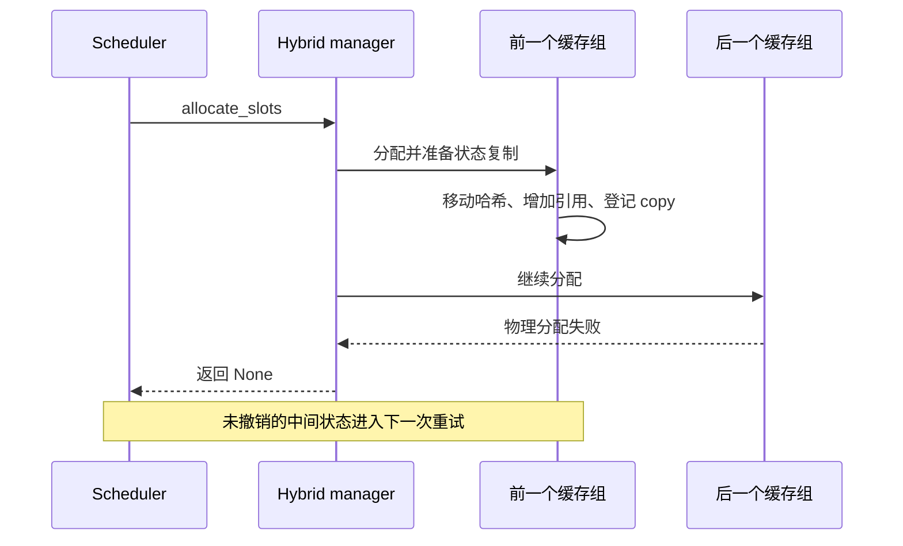
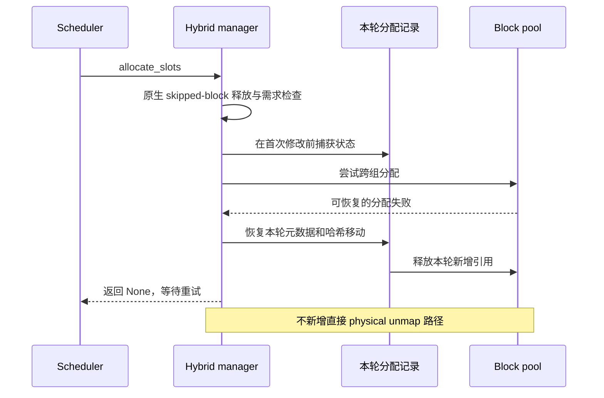

## 返回 None 之后，重试从什么状态开始？

弹性缓存的物理分配可能失败，这本来可以转成 allocation miss，让调度器稍后重试。但混合缓存的一次分配跨越多个 group：前一个 group 可能已经拿到块，移动了哈希、增加引用计数，并排入一次 Mamba 状态复制；后一个 group 才发现物理容量不足。

仅捕获异常并返回 None，只恢复了调用方看到的返回值，没有恢复那些已经改变的状态。等待中的请求不会自动替我们撤销分配；直接把整个请求释放也不对，运行中的请求还有此前已提交、仍需使用的块。



vLLM 0.29 的原生 Mamba 路径中，下面这些操作都发生在分配流程里，不必等 Worker 真正开始计算：

```python
self.block_pool.move_block_hashes(source_block, cow_block)
self._pending_cow_copies.append((source_block, cow_block))
source_block.ref_cnt += 1
```

[对应 vLLM 源码](https://github.com/vllm-project/vllm/blob/98dff2a81d747d1dba01a47f939f48c3526d4206/vllm/v1/core/single_type_kv_cache_manager.py#L1737-L1755)

## 只撤销这一次未发布的尝试

修复在原生 skipped-block 释放之后、第一次分配修改之前捕获必要状态。物理分配失败时，恢复本轮请求表和 Mamba 元数据，反向恢复本轮移动的哈希，只截掉本轮追加的 copy/offload 记录，再通过已有引用计数路径释放新增引用。此前的块和更早排入的复制任务保持不变。



[合入版 allocation_attempt.py](https://github.com/ovg-project/kvcached/blob/32858759eb11d94a1cc34aaf65004da70b46c5e9/kvcached/integration/vllm/allocation_attempt.py)

## 另一个问题：旧边界不能指向已经推进的状态

Mamba 的运行态会随 decode 推进。假设 prompt 边界为 B，原状态复制到检查点后，运行块继续向 B+1 推进；如果异步调度仍用旧的请求长度把运行块再次登记到 B，下一次复制就可能把 B+1 的状态存到 B 的 hash 下。HTTP 请求仍可能成功，但后来的缓存命中拿错了状态。

修复仅在 RUNNING 请求、发布边界不超过已计算 token 数时跳过这次过期发布。首次或分块 prefill、抢占后重放等仍保留原生路径。版本限定在 vLLM 0.28/0.29，不泛化到未来版本；也不替代 #464 对物理释放顺序的修复。

## 验证不能只看输出有没有结束

公开测试用真实 0.28/0.29 管理器覆盖等待、运行、抢占、重复 miss、引用与复制所有权。T4 使用 tiny random Qwen3.5 hybrid checkpoint，在 copy 已排队后注入真实物理分配失败，检查完整请求、输出 token、恢复和退出。

普通 native/elastic 输出对比并非全部逐 token 一致，因此继续隔离调度差异：对剩余 0.29 用例，在首次 decode 前逐一比较六个 Mamba conv/SSM tensor、attention prefix 和实际复制目的地，均完全相同；随后在关闭 KVCached 的原生对照里复现同样的调度失败与缓存重算，完整输出才与对应故障组匹配。

这说明要区分状态损坏与调度改变后 FP16 近分数输出的差异，不能只拿 HTTP 200 宣布正确，也不能看到不同 token 就直接认定复制错了。证据限定于这些所有权与状态恢复场景，不代表完整模型质量、多卡或吞吐已通过验收。

[PR #518：完整复现、源码与验证边界](https://github.com/ovg-project/kvcached/pull/518)
