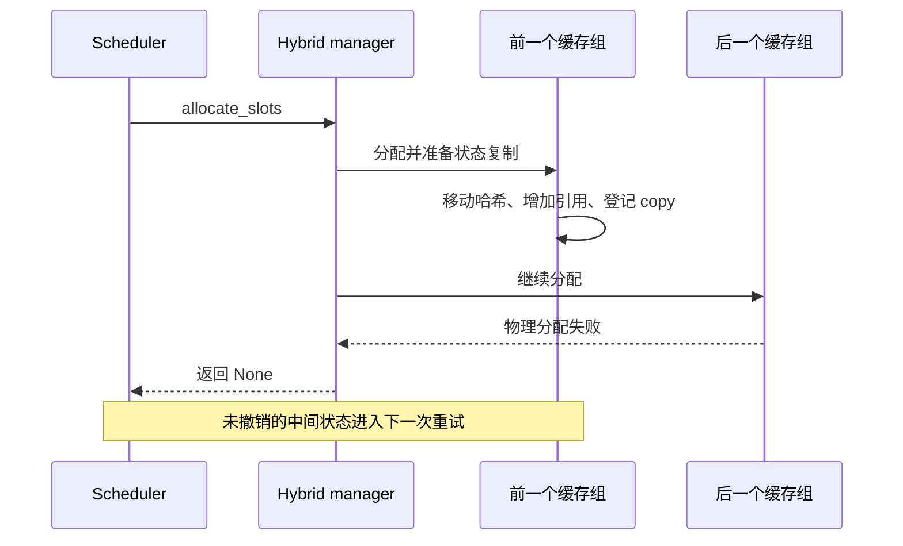
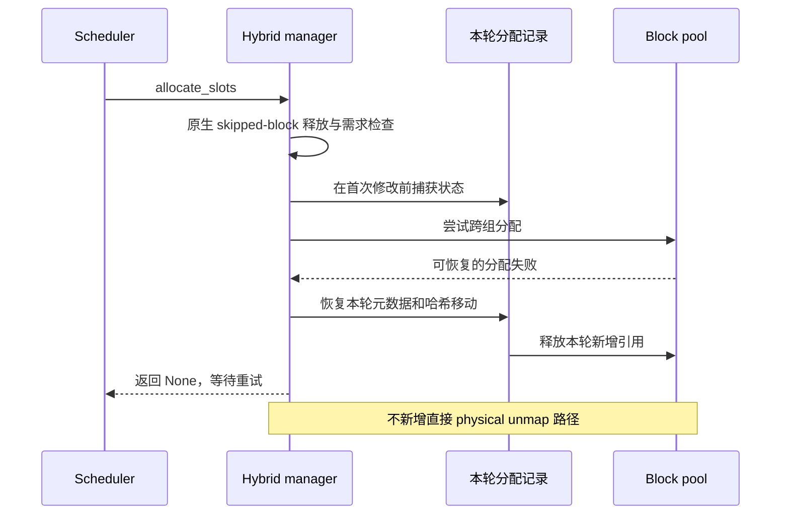

## 第二组没拿到显存，第一组已经改了记录

一次请求可能要同时给注意力缓存和 Mamba 状态分配空间。vLLM 会依次处理这些缓存组。轮到第二组时才发现显存不够，调度器可以决定稍后再试。但第一组可能已经移动了缓存键、给源块加了一次引用，还把一次状态复制放进了队列。下一次分配会从这个改了一半的状态开始。



下面三行就发生在分配期间。它们记下「以后要复制哪个块」，并让源块在复制前一直可用。worker 这时还没开始跑模型。[vLLM 的 Mamba 分配代码](https://github.com/vllm-project/vllm/blob/98dff2a81d747d1dba01a47f939f48c3526d4206/vllm/v1/core/single_type_kv_cache_manager.py#L1737-L1755)

```python
self.block_pool.move_block_hashes(source_block, cow_block)
self._pending_cow_copies.append((source_block, cow_block))
source_block.ref_cnt += 1
```

## 只撤回这一次加进去的东西

正在运行的请求还要用前几轮分到的块，所以不能把整个请求清空。这段回滚逻辑适用于 vLLM 0.28.x 和 0.29.x 的缓存协调器。它在引擎释放已跳过的块之后、这轮首次修改之前，记下请求原有的状态。遇到可重试的分配失败，就恢复这轮移动的键和元数据，删掉新追加的复制记录，把新增的引用还回去。前几轮算好的状态和已经排队的任务都保留下来。[回滚实现](https://github.com/ovg-project/kvcached/blob/32858759eb11d94a1cc34aaf65004da70b46c5e9/kvcached/integration/vllm/allocation_attempt.py)



## 还有一种错会留到下次命中缓存才出现

假设已经保存了读完第 B 个 token 时的 Mamba 状态。生成下一个 token 后，工作块已经走到 B+1，异步调度拿到的请求长度却可能还停在 B。如果再用 B 登记这个工作块，后面的请求查 B 时就可能拿到多算了一步的状态。

修复针对运行中的请求，跳过这种已经计算过的旧位置。首次处理输入、分段处理长输入和抢占后的重放仍然可以按原来的方式保存状态。

## 注入一次失败，再看重试从哪里接上

PR 用 vLLM 0.28 和 0.29 的管理器测试重复失败、抢占和重试。在单张 T4 上，还用一个很小的随机 Qwen3.5 混合模型，等复制已经排队再故意让物理分配失败，随后让请求跑完。

有一组 0.29 的输出和普通运行不完全一样。于是把检查点前移到第一次生成 token 之前，对照六个 Mamba 状态张量、注意力缓存前缀和真正写入的复制目标，这些都一致。再让关闭 KVCached 的 vLLM 经历同样的调度失败和重算，完整输出也对上了。这才把重试时的状态恢复和批次变化造成的输出差异分开。[原始实验和对照](https://github.com/ovg-project/kvcached/pull/518)
