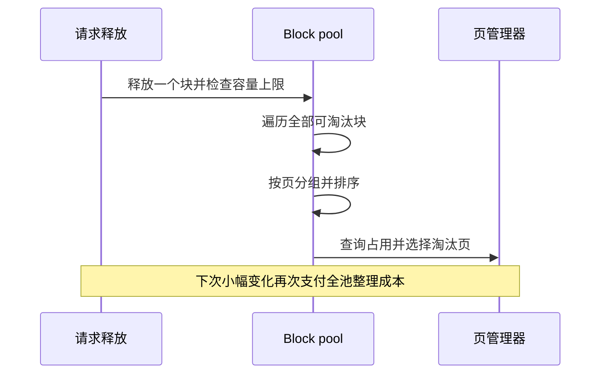
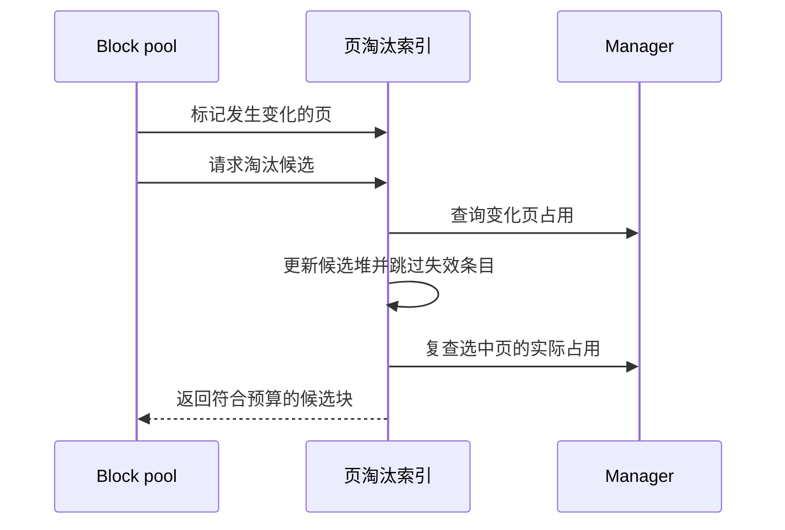

## 释放一个块，却把整个池重新整理了一遍

给前缀缓存设置容量上限，是为了保留有用的缓存，而不是无限占用显存。问题在于执行这个限制的方式：旧路径在裁剪时重新遍历可淘汰块，按物理页分组，再排序选择淘汰对象。保留的缓存越多，一次很小的释放也越贵。

这不是 GPU 算子变慢，而是 CPU 调度路径反复做了与本次变化不成比例的工作。缓存池保留 1000 个块，连续释放单个块，正好能把这个成本单独测出来。



## 把没有变化的部分留在索引里

修复引入按页维护的淘汰索引。块被加入、移除或复用时，只标记对应页发生了变化；裁剪时更新这些页的候选信息。候选堆按代价和近期使用顺序排序，旧条目通过版本信息失效，累积过多时重建堆，避免索引无限增长。

物理页占用仍由 manager 决定。页里可能还有 null block 或待复制任务持有的块，不能只根据前缀索引的数量推断整页可释放。选中候选后还要复查占用。整页淘汰不够时，原有 LRU 补选在拿到足够数量后停止。



下面是合入版本的 `changed()`，关键是记录页，而不是在每次修改时重新整理所有块：

```python
def changed(self, block_ids: Iterable[int]) -> None:
    self.dirty.update(self.page_id(bid) for bid in block_ids)
```

[PageEvictionIndex 合入源码](https://github.com/ovg-project/kvcached/blob/9677e504960edd4ccc7a820592e28b5df7bbd9f3/kvcached/integration/vllm/page_eviction.py)

## 快了多少，测的又是什么

公开 PR 的初轮实验使用 T4、vLLM 0.28、真实 native 元数据与 CUDA backing，保留 1000 个块，预热后测量 2000 次单块释放。连续布局的平均裁剪时间从 260.5 微秒降到 17.4 微秒，非连续布局从 259.6 降到 17.5 微秒。后续加入 manager 释放通知的局部刷新后，记录约为 19–20 微秒。

这是缓存裁剪微基准，不是模型服务吞吐提升十几倍。两组都保留 1000 个块、映射 256 MiB；另有淘汰顺序对照、单块裁剪工作量约束和真实 CUDA 释放测试，目的是确认收益不是来自少保留缓存或改变淘汰规则。

## 增量索引最容易漏掉的地方

索引必须跟上所有改变占用的路径，不只是 `add()` 和 `remove()`。manager 侧直接释放页，也需要通知索引刷新受影响的页。反过来，通知不能退化成“任何页释放都让整个索引失效”，否则又回到全池扫描。

严格容量上限与原有最低代价页/LRU 策略保持不变。这里优化的是实现成本，不是引入新的缓存调度政策。

[PR #538 与公开测试记录](https://github.com/ovg-project/kvcached/pull/538)
