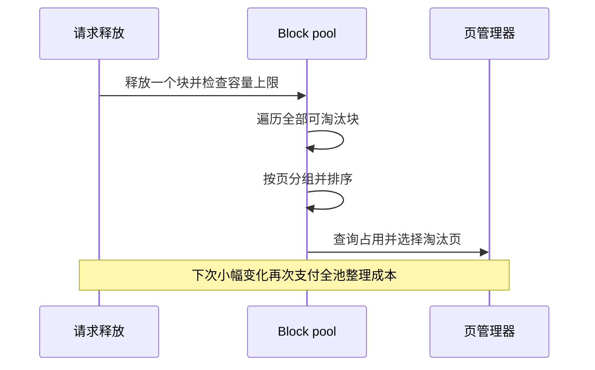
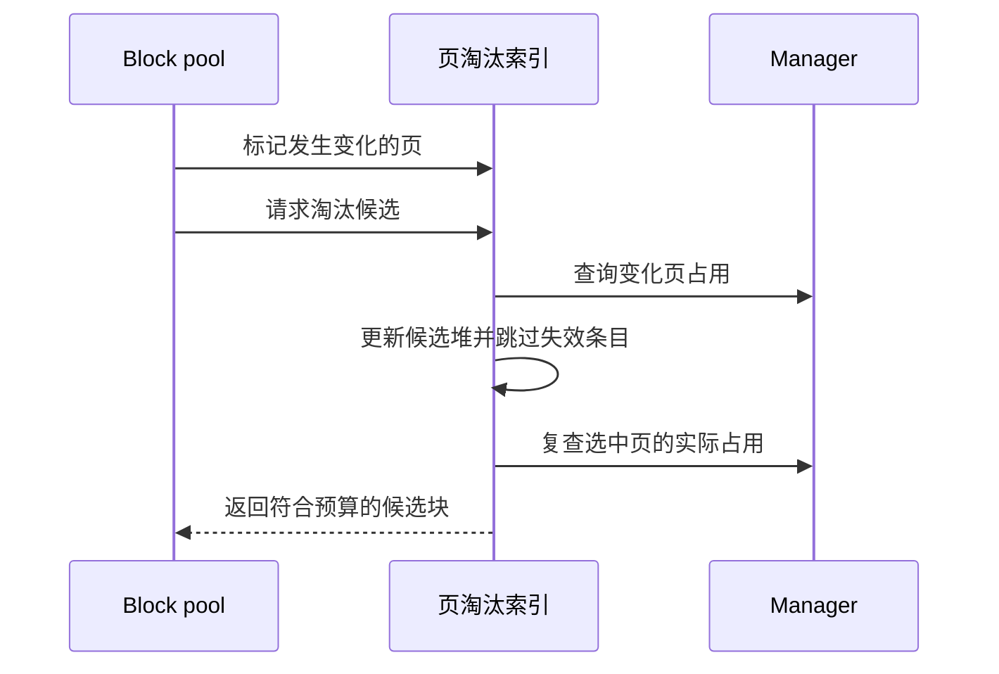

## 只释放一个块，CPU 都做了些什么？

前缀缓存会留下算过的块，方便后面的请求复用。超过容量上限时，管理器要选一些块淘汰。旧代码每次都把所有可淘汰的块按物理页重新分组、排序，再挑代价最低的页。即使刚刚只释放了一个块，它也得把整个池子过一遍。

把池子固定在 1000 个块，连续逐个释放，就能单独看见这笔 CPU 开销。



## 记下是哪一页发生了变化

块加入缓存、被移除或再次使用时，代码现在只记下它所在的页。下次裁剪先更新这些页的记录，原来排好的其他候选页可以接着用。挑中一页后还要向管理器核对一次，因为等待复制的块等其他使用者可能也占着这页。[页索引实现](https://github.com/ovg-project/kvcached/blob/9677e504960edd4ccc7a820592e28b5df7bbd9f3/kvcached/integration/vllm/page_eviction.py)

```python
def changed(self, block_ids: Iterable[int]) -> None:
    self.dirty.update(self.page_id(bid) for bid in block_ids)
```



管理器有时会从缓存索引以外的地方释放块。它也得通知索引哪几页变了，否则本来已经空出来的页可能一直进不了候选名单。需要额外按最近使用时间挑块时，找够数量就可以停。

## 在相同缓存大小下重测

PR 在单张 T4 上保留 1000 个块、映射 256 MiB，预热后测量了 2000 次单块释放。连续布局下，一次裁剪平均从 260.5 微秒降到 17.4 微秒。块分散存放时，从 259.6 降到 17.5 微秒。后来补上管理器的释放通知，再测约为 19–20 微秒。

两边使用相同的容量上限。回归测试还对照了新旧实现选出的淘汰顺序。这组数字量的是调度器花在单次裁剪上的时间。[基准配置和结果](https://github.com/ovg-project/kvcached/pull/538)
