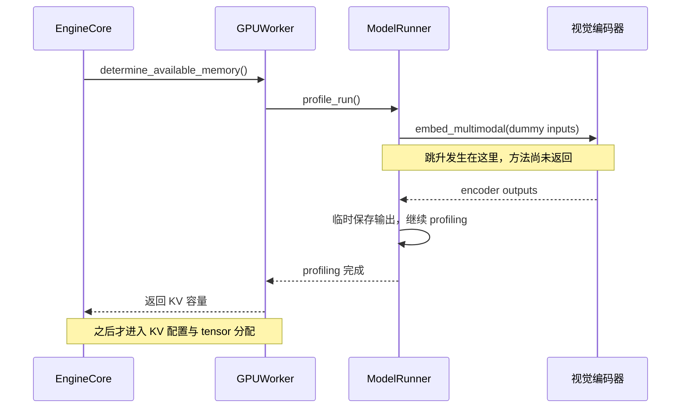
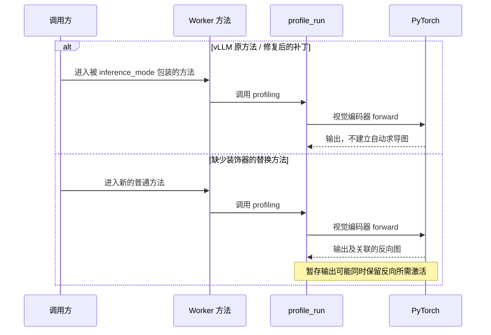

## 显存是在分配 KV 缓存之前涨的

我在 #448 里替换了 vLLM 的启动方法，让同卡的几个实例可以各自估算缓存容量。小文本模型试跑通过了。换成多模态模型后，同样的输入，单进程显存却从约 2.9 GiB 涨到 14.06 GiB。最先怀疑的是新的容量算法给缓存分多了。[之前的改动](https://github.com/ovg-project/kvcached/pull/448)

于是把启动过程拆开测。最大的差距出现在视觉编码器处理测试图片的那次调用。此时负责估算容量的方法都还没返回，KV 张量要等这一步完成后才开始分配。



## 把两次试跑停在同一行

两次用了同一镜像、同一模型和相同的启动参数，只替换补丁文件。视觉编码器收到的图像张量也一样，形状都是 `(65536, 1536)`，类型都是 `bfloat16`。进入编码器时，PyTorch 记录的张量占用相同。一从编码器返回，两边就已经差了 12 GiB 以上。[原始测量](https://github.com/ovg-project/kvcached/issues/460)

| 观察位置             |  #448 之前 | 带 #448 的路径 |
| -------------------- | ---------: | -------------: |
| embed 前的 allocated |  0.867 GiB |      0.867 GiB |
| embed 后的 allocated |  0.944 GiB |      13.13 GiB |
| PyTorch 峰值         |  1.943 GiB |      13.62 GiB |
| 进程显存占用         | 约 2.9 GiB |   约 14.06 GiB |

## 漏掉的那一行在调用者身上

vLLM 0.22.1 在外层 worker 方法上写了 `@torch.inference_mode()`。里面的 `profile_run()` 直接沿用这个设置。#448 替换了整个外层方法，调用的还是同一个编码器，装饰器却留在被替换的函数上了。[worker 入口](https://github.com/vllm-project/vllm/blob/v0.22.1/vllm/v1/worker/gpu_worker.py#L357-L373) · [编码器调用和临时缓存](https://github.com/vllm-project/vllm/blob/v0.22.1/vllm/v1/worker/gpu_model_runner.py#L6104-L6161)

没有推理模式，PyTorch 可以为反向传播保存中间张量。试跑又会临时缓存编码器输出。这些输出还引用着计算图，于是编码器返回后，大量显存仍然被占着。



## 在试跑函数里面测推理模式

#461 把装饰器加回替换方法。模型仍然跑一遍，输入和预算公式也照旧。[合入代码](https://github.com/ovg-project/kvcached/blob/60cad949389af6bbf1d65c4eddf325113df5a9eb/kvcached/integration/vllm/patches.py#L2058-L2069)

```python
@torch.inference_mode()
def _patched_determine_available_memory(
    self, *args: Any, **kwargs: Any
) -> int:
    ...
```

只检查最后算出来的容量，抓不住这类回归。新的测试在模型试跑和 CUDA Graph 显存测量的调用里分别检查两件事，梯度记录已经关闭，推理模式已经打开。这样下次替换函数时再漏掉装饰器，测试会在发生问题的位置报错。[回归测试](https://github.com/ovg-project/kvcached/blob/60cad949389af6bbf1d65c4eddf325113df5a9eb/tests/test_vllm_virtual_kv_capacity.py)

```python
assert torch.is_grad_enabled() is False
assert torch.is_inference_mode_enabled() is True
```
