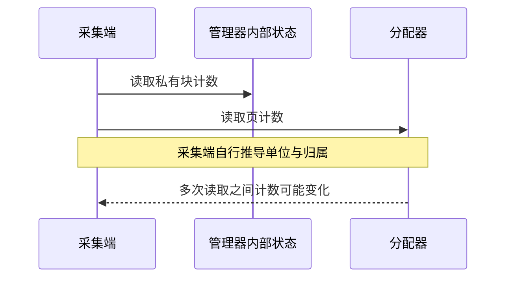
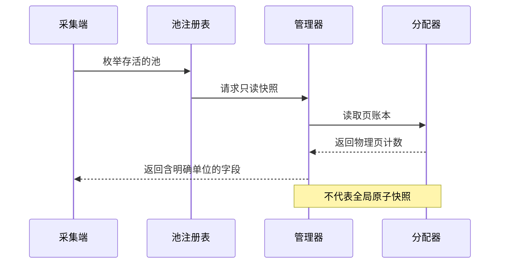

## 一个池子，三个不同的数

在 PR 的 RTX 4090 测试里，一个小型 KV 缓存池留了 32 MiB 的地址空间，其中 8 MiB 已经映射到显存。此时按已分配块计算，用量只有 512 字节。三个数同时成立，回答的分别是「可以寻址多大」「已经有多少物理显存支撑」和「分配器登记了多少已分配块」。最后一项也包含管理器留作备用的块。

以前，监控得自己找管理器和分配器里的字段做换算。拿到某一层的大小，还得知道有多少层、每层有几个缓冲区，否则算出来的整池容量就会差一个倍数。



## 让缓存池自己报告用量

vLLM 和 SGLang 创建的池会登记到一个注册表里。引擎进程内的采集程序可以一次取出存活池的快照，也可以指定只取哪个引擎的数据。池名和分组编号都在返回值里，采集端按需筛选，再发给监控系统。注册表只保留弱引用，监控接入后，池仍然可以正常销毁。



从单个缓冲区算到整个池，用到下面这几项。逻辑空间里空着的页还要看能否拿到物理显存，才能估算当前可用量。底层缺少这项数据时，接口会报告未知，图表也就能区分「没读到」和「真的用光了」。[字节换算](https://github.com/ovg-project/kvcached/blob/c85bac20e5ccb04766f995512abbff0dfbca1055/kvcached/observability.py#L183-L186) · [可用页计算](https://github.com/ovg-project/kvcached/blob/c85bac20e5ccb04766f995512abbff0dfbca1055/kvcached/observability.py#L166-L173)

```python
virtual_bytes_per_buffer = _int_attr(manager, "mem_size") or 0
virtual_per_layer_bytes = virtual_bytes_per_buffer * num_kv_buffers
block_size_bytes = _int_attr(manager, "block_mem_size") or 0
bytes_per_block = block_size_bytes * num_layers * num_kv_buffers
```

## 分出去的 32 个块还能看见吗？

测试先读一次，然后分配 32 个块、再归还。快照中的块数依次为 1、33、1，按块计算的用量也从 512 字节升到 16,896 字节，再回到 512。这个例子能直接检查单位和字段是否对应得上。[RTX 4090 测试记录](https://github.com/ovg-project/kvcached/pull/385)

这版接口逐项读取底层计数。遇到后台线程同时调整池大小时，几个计数可能来自不同的时刻。后来的 [#443 手记](#/notes/allocator-snapshots) 讲了怎样让分配器一次读出彼此一致的页数。
