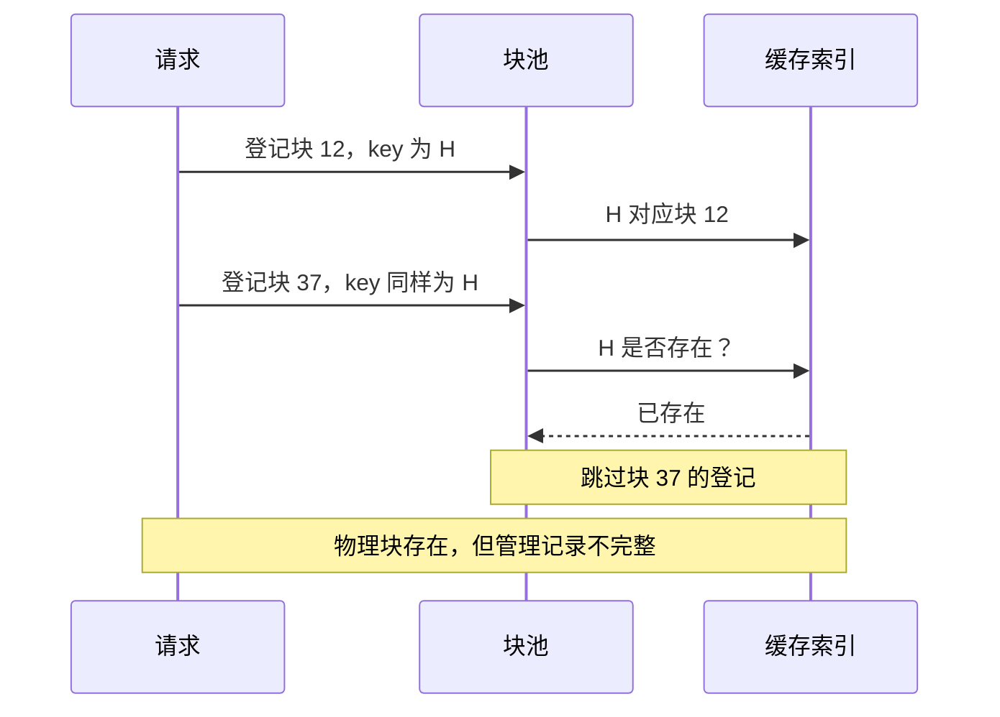
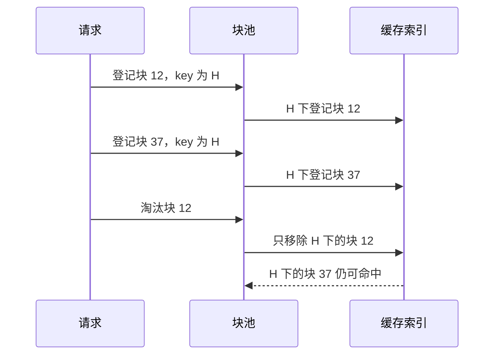

## 同一段开头，两个块号

假设两个请求在相近的时间算出了同一段前缀，一个把结果放进 12 号块，另一个放进 37 号块。内容和缓存分组一样，所以它们的缓存键都是 H。下一次查 H，复用其中任意一个块就够了。释放显存时，两块却都得找得到。

旧索引把 H 登记给 12 号块。轮到 37 号块时，代码发现 H 已经存在，直接跳过。于是 37 号块确实占了空间，自身的哈希和反向索引却都没填。vLLM 后面检查这些块时，可能因为哈希为空而中止引擎。



## 用内容查找，用块号删除

修复后的 H 底下可以同时登记 12 和 37。请求照常拿其中一个可用块。淘汰 12 时，用它自己的编号删除记录，37 仍然可以命中。等最后一个副本离开，才删掉 H。块被拿来存别的前缀时，也要先清理它原来所属的键。[查找代码](https://github.com/ovg-project/kvcached/blob/fc26d25b584841545ca1794057223f417ef5a4ae/kvcached/integration/vllm/patches.py#L458-L462) · [登记代码](https://github.com/ovg-project/kvcached/blob/fc26d25b584841545ca1794057223f417ef5a4ae/kvcached/integration/vllm/patches.py#L574-L581)



```python
def _remove_cached_block(
    self, key: Any, block_id: int
) -> Optional[KVCacheBlock]:
    blocks = self._cached_blocks.get(key)
    if not blocks:
        return None
    block = blocks.pop(block_id, None)
    if not blocks:
        self._cached_blocks.pop(key, None)
    return block
```

[按块号移除的实现](https://github.com/ovg-project/kvcached/blob/fc26d25b584841545ca1794057223f417ef5a4ae/kvcached/integration/vllm/patches.py#L464-L473)

## 专门测一次「只淘汰一个副本」

回归测试先登记两个内容相同的块，释放两个块，再只淘汰其中一个。用同一个缓存键再查一次，还能找到另一个块。PR 记录了 30 个前缀缓存测试通过。双实例并发回放中，1440 个请求全部完成，期间没有再触发那条哈希断言。[测试记录](https://github.com/ovg-project/kvcached/pull/402)
