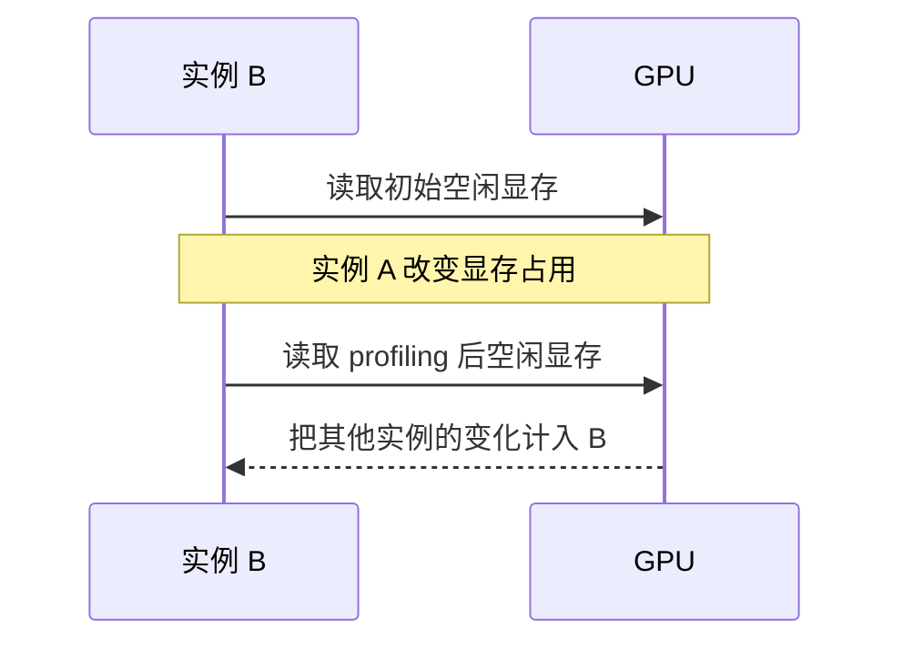
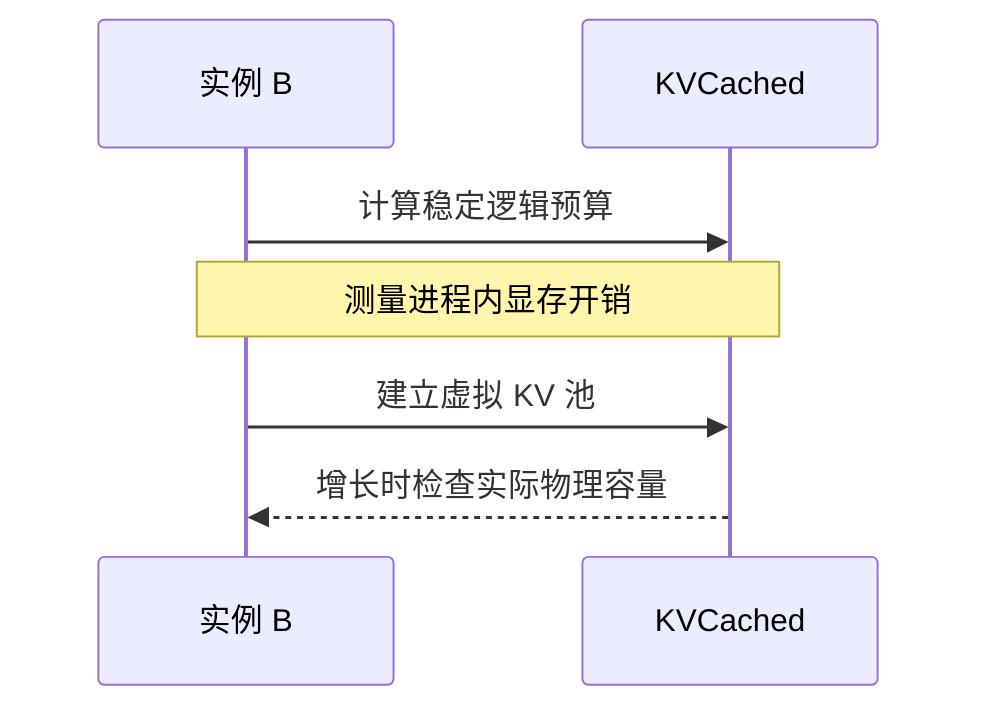

## 越测空闲显存越多，服务反而起不来

vLLM 启动时会试跑模型，根据试跑占用的显存估算还能留多少给 KV 缓存。一次共用 GPU 的启动记录里，试跑前整卡空闲 8.57 GiB，跑完后却有 12.91 GiB。vLLM 预期试跑会消耗显存，看到方向相反的数字就触发了断言。

差值里混进了其他进程的活动。即使让两个实例依次启动，先启动的那个也会继续接请求，随时可能申请或释放显存。[故障记录](https://github.com/ovg-project/kvcached/pull/448)



## 先算这个实例能用的地址空间

如果手动设置了 `kv_cache_memory_bytes`，启动时仍按 vLLM 的原有逻辑使用该预算。启用 KVCached 并选择自动估算时，vLLM 用整卡容量乘以配置的利用率，得到本实例的虚拟预算。再扣除本进程的权重和试跑时 PyTorch 的峰值增量，估算可以给 KV 缓存留多大的地址空间。下面是简化后的计算。[合入代码](https://github.com/ovg-project/kvcached/blob/f8bbb005ed5c1eb9285e2e8f2afa7fc83b8da052/kvcached/integration/vllm/patches.py#L2071-L2126)

```python
# Simplified capacity formula, not the full worker method.
available_memory = (
    virtual_budget
    - weights_memory
    - torch_peak_increase
)
```



等缓存真的要增长时，分配器再检查还有没有物理页。哪怕预算算出来很大，机器一直腾不出第一页，启动仍会等待。SGLang 的适配还要照顾多个进程，每个进程先算自己的容量，再共同取最小值，这样各自建出的池尺寸才一致。

## 原来的测试漏了哪条路径

PR 在单张 T4 上分别启动 vLLM 0.24.0 和 SGLang 0.5.15，两边都成功回答了请求。SGLang 那次测试关闭了 CUDA Graph。后来换多模态模型时，又发现替换 vLLM 启动方法漏掉了推理模式，视觉编码器试跑多用了十几 GiB。排查过程在[下一篇手记](#/notes/inference-mode)里。[启动测试记录](https://github.com/ovg-project/kvcached/pull/448)
