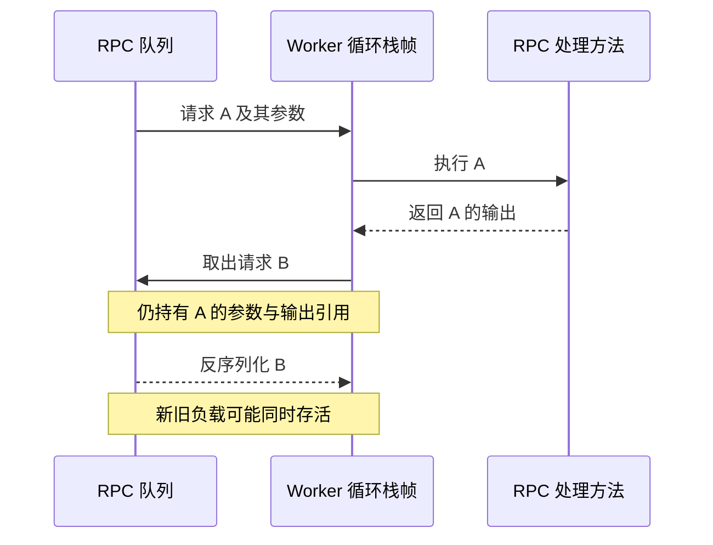
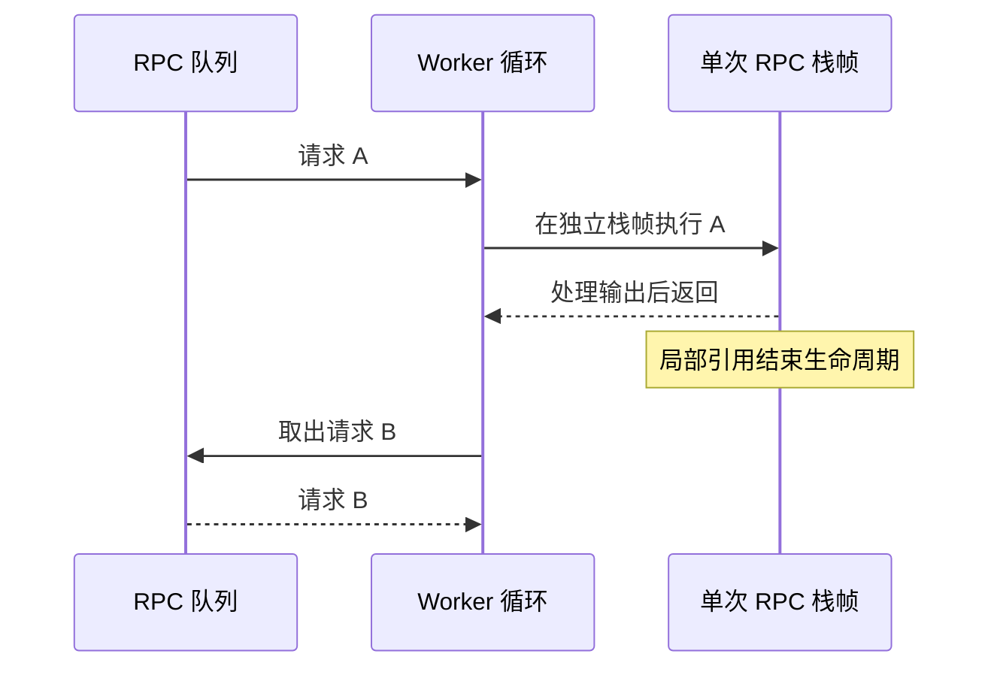

## 两条请求的内存是怎么叠在一起的

假设 worker 刚处理完请求 A，参数里有一块很大的 CPU 张量。它把结果发回去，转头从队列里取请求 B。乍看之下，两次调用已经错开了。问题藏在这行 Python 的执行顺序里。

```python
method, args, kwargs, output_rank = self.rpc_broadcast_mq.dequeue(
    indefinite=True
)
```

Python 要先算出等号右边的值，才能替换左边的变量。队列正在解包 B 时，循环里的 `args` 还指着 A，`output` 也可能留着 A 的结果。两批数据在这段时间里同时占用内存，大张量让这个短暂的峰值尤其明显。



## 让一次调用在一个函数里结束

外层循环现在只管取消息。解包、执行、发回结果都放进 `_execute_worker_rpc()`。函数一返回，本次调用的局部变量就离开作用域，然后循环才取下一条消息。原来由哪个 worker 回传结果，以及执行出错时怎样回报，都沿用原来的处理逻辑。[循环入口](https://github.com/vllm-project/vllm/blob/4ca856b0b59d87c7b167d1bd8c748421719c9a57/vllm/v1/executor/multiproc_executor.py#L1029-L1033) · [单次调用的实现](https://github.com/vllm-project/vllm/blob/4ca856b0b59d87c7b167d1bd8c748421719c9a57/vllm/v1/executor/multiproc_executor.py#L1035)

```python
def worker_busy_loop(self):
    """Main busy loop for Multiprocessing Workers"""
    assert self.rpc_broadcast_mq is not None
    while True:
        self._execute_worker_rpc(self.rpc_broadcast_mq.dequeue(indefinite=True))
```



## 在开始取 B 的一刻检查 A

测试给 A 的负载留了一个弱引用。开始取 B 时，旧实现还能通过它找到 A，新实现里 A 已经释放。这个检查比看进程总内存直接得多，因为分配器可以留下已经归还的内存供以后复用。

PR 还把同一处改动移植到 vLLM 0.18.0，在单张 T4 上用小型 MoE 模型跑了两轮。平均吞吐从 118.215 变为 118.222 tok/s，两组几乎一样。这次修掉的是两批数据在内存中重叠的那段时间。[测试记录](https://github.com/vllm-project/vllm/pull/51979)
